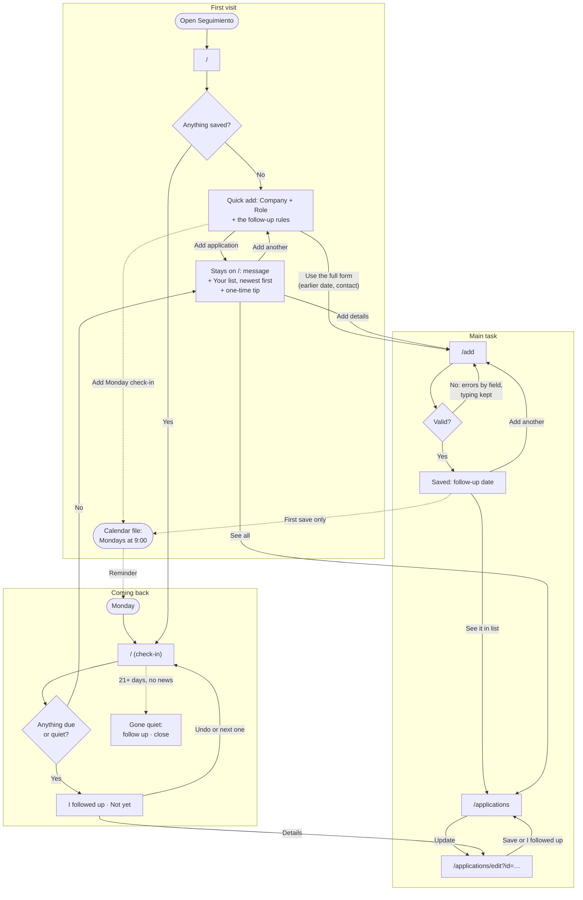

# Seguimiento

A weekly check-in for a job search: it tells you who to follow up with.

## Who it's for

A second-year grad student applying to jobs in Chicago. They apply in bursts between classes, on a phone and a laptop, and lose track of who to follow up with. It's a weekly ritual, not a CRM.

## The main task

Log an application → it's on my list with a follow-up date → on Monday, Seguimiento tells me who to follow up with.

## The flows

The steps, states and errors behind this diagram are in [flows.md](flows.md).

## Onboarding research

**What I looked at.** How three job-search tools welcome someone new: [Huntr](https://huntr.co/product/job-tracker), [Teal's Job Tracker](https://www.tealhq.com/tools/job-tracker) and [Simplify](https://simplify.jobs/). All three hide their first screen behind sign-up, so I used public sources only: help centers, product pages, store listings and reviews. The full findings, with a link for every fact, are in [docs/onboarding-research.md](docs/onboarding-research.md). The sources I relied on most:

- Teal opens with "a few sample jobs already populated in your Job Tracker" ([help center](https://web.archive.org/web/20250916015333/https://help.tealhq.com/en/articles/9508859-getting-started-job-tracker)), and its guidance is to follow up after applying and archive "if no response after 3 weeks" ([guidance](https://web.archive.org/web/20250916013120/https://help.tealhq.com/en/articles/9530119-job-tracker-guidance)). It emails "an automated reminder on the day of" ([blog](https://web.archive.org/web/20250517122840/https://www.tealhq.com/post/job-search-tracking-spreadsheet)), and tracks a weekly goal, Monday to Sunday, from a target date it asks for at sign-up ([help center](https://web.archive.org/web/20250814115130/https://help.tealhq.com/en/articles/9509646-job-application-widget)).
- Huntr's AI tools "become accessible once a job is saved" ([help center](https://help.huntr.co/en/articles/10393367-your-huntr-dashboard)), and it sends Weekly and Daily Digest emails ([account settings](https://help.huntr.co/en/articles/10503230-account-faq-and-account-settings)). An App Store reviewer was "really confused about how to use this without filling up my board with a bunch of test company names" ([App Store](https://apps.apple.com/app/id1372389812)).
- Simplify asks for target roles, location, salary and experience, plus a matching quiz ([sign-up](https://help.simplify.jobs/articles/0738509-signing-up-for-simplify), [quiz](https://help.simplify.jobs/en/articles/7272801-setting-your-job-match-preferences)). It then opens on a "Profile Strength" score ([profile strength](https://help.simplify.jobs/articles/7361554-building-your-profile-strength)), prompts you to install its extension ([Copilot](https://help.simplify.jobs/articles/1749022-installing-and-setting-up-copilot)), and counts a streak for viewing 5 matches a day ([dashboard](https://help.simplify.jobs/articles/6390631-navigating-your-dashboard)).

**What I took.**

- **Something useful before any effort**, as with Teal's sample jobs. The first visit shows a labeled example Monday, not data.
- **The first save unlocks something**, as with Huntr's AI tools. The first save gives a follow-up date, and the confirmation leads with it.
- **Teal's follow-up rhythm, stated out loud.** Under the example, one line says Seguimiento suggests a follow-up a week after you apply, and that after 3 weeks with no news an application is marked gone quiet. Saying the rule explains why dates appear on their own.
- **A Monday-to-Sunday week**, like Teal's weekly goal, but without the target. This week opens with "Week of Oct 19".
- **A reminder to come back**, like Teal's reminder emails and Huntr's digests. Seguimiento has no server and can't email, so the first visit, and the confirmation after the first save, offer **Add Monday check-in to my calendar**. It downloads a calendar file with a weekly event on Mondays at 9:00 that you add to your own calendar.
- **Value right away, from your own data.** Instead of Teal's sample jobs, a line under the main button says: log applications you've already sent, with the day you applied, and anything from a week ago or more shows up right away in This week.

**What I rejected and why.**

- **Signing up before seeing anything** (all three tools). Seguimiento has no accounts. Everything stays in this browser, and you can start right away.
- **Questionnaires up front** (Simplify's salary, experience and matching quiz; Teal's target date). Nothing is asked before "Log your first application". A grad student logging between classes shouldn't have to set anything up first.
- **Sample data in the real list** (Teal). Huntr's App Store review shows what goes wrong: you can't tell how to try the app without filling it with fake companies. The example is a picture, so there's nothing to clear later.
- **Streaks and quotas** (Simplify's daily streak; Teal's goal of up to 12 applications a week). For a once-a-week ritual, they add pressure without helping you decide who to contact.
- **Setup scores and install prompts** (Simplify's "Profile Strength"; the Teal and Simplify extension prompts). They make the first screen about setting up the tool, not about your job search.

## First visit

_To fill in._

## Coming back

_To fill in._

## What it remembers

_To fill in._

## Accessibility

_To fill in._

## First-run check

_To fill in._

## Running locally

_To fill in._
