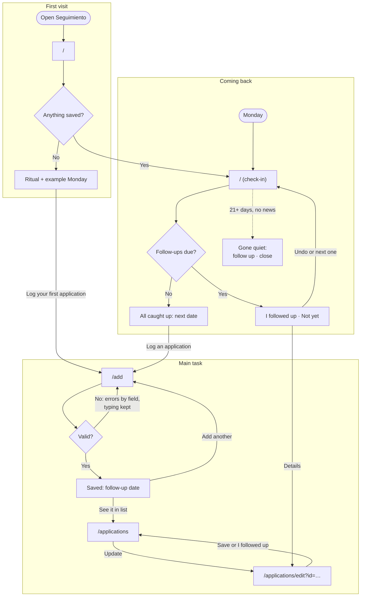

# Seguimiento

A weekly check-in for a job search: it tells you who to follow up with.

## Who it's for

A second-year grad student applying to jobs in Chicago. They apply in bursts between classes, on a phone and a laptop, and lose track of who to follow up with. It's a weekly ritual, not a CRM.

## The main task

Log an application → it's on my list with a follow-up date → on Monday, Seguimiento tells me who to follow up with.

## The flows

The steps, states and errors behind this diagram are in [flows.md](flows.md).

## Onboarding research

_To fill in._

## First visit

_To fill in._

## Coming back

_To fill in._

## What it remembers

_To fill in._

## Accessibility

_To fill in._

## First-run check

_To fill in._

## Running locally

_To fill in._
