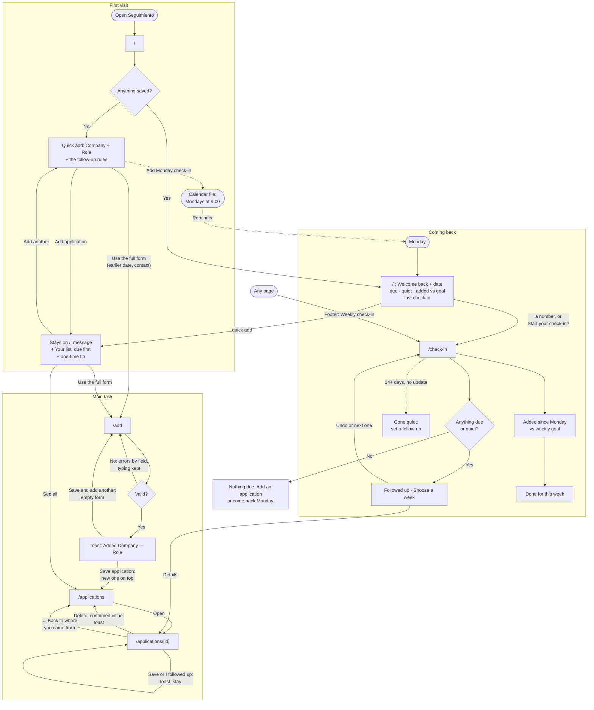

# Seguimiento

**Live:** https://projectdbsa3.vercel.app

A weekly check-in for a job search: it tells me who to follow up with.

## 1. The tool, who it's for, and what brings them back

Seguimiento is a job-application tracker built around follow-ups. I log each application as I send it, and it gives me a follow-up date. It's for a grad student applying to jobs in Chicago: me. I apply in bursts between classes, on my phone and my laptop, and I lose track of who to follow up with. So it's a weekly ritual, not a CRM.

What brings me back is the **Monday check-in** at `/check-in`. It lists:
- the follow-ups due, each with **Followed up**, **Snooze a week** or **Open**;
- what's gone quiet (2 weeks with no update), with **Set a follow-up**;
- how many I added this week, against a weekly goal;
- **Done for this week**, which says "Done. See you next Monday."

To get there:
- **Home:** coming back, it opens with "Welcome back." and three numbers. "Follow-ups due" and "gone quiet" link to the check-in; "added this week" links to the list.
- **Calendar:** on the first visit I can add a weekly Monday 9:00 reminder to my own calendar.
- **Footer:** every page links to the Weekly check-in.

## 2. The flows

**The main task:** Log an application → it's on my list with a follow-up date → on Monday, Seguimiento tells me who to follow up with.

The steps, states and errors behind this diagram are in [flows.md](flows.md).



## 3. Onboarding

### What someone new sees

There's no sign-up and no tour. The first screen at `/` is the task itself ([screenshot](docs/screenshots/01-first-visit.png)):
- **The headline:** "Keep every application moving.", with one line under it: "Log what you applied to, and come back on Monday to see who to follow up with."
- **A two-field quick add:** Company and Role, with four role chips (Data Analyst, Research Associate, Policy Analyst, Associate Consultant). Then "Applied earlier, or want to add a contact? Use the full form." and **Add application**.
- **"Saved on this device. No account."**
- **The rule, in one line:** Seguimiento suggests a follow-up a week after you apply, and after 2 weeks with no update an application is marked gone quiet.
- **A reminder:** **Add Monday check-in to my calendar**, plus "Load a backup" for someone who already uses it on another device.

### Something useful right away

One company and one role, then **Add application**, and the first result is already there:
- **A follow-up date:** the toast says "Added Example Co — Data Analyst. Follow up on Tue, Oct 27."
- **Your list:** the application appears under the form, with that date and a one-time tip: "We suggested a follow-up a week out. Change it anytime."
- **Nothing blocks you:** a mistake costs nothing. An empty Role says "Enter the role title." next to the field, keeps what I typed, and puts the cursor there ([screenshot](docs/screenshots/04-empty-role-error.png)).
- **Older applications count too:** logged through the full form with the day I applied, one from a week ago or more is already due on the check-in.

### What I took from the research

**What I looked at.** How three job-search tools welcome someone new: [Huntr](https://huntr.co/product/job-tracker), [Teal's Job Tracker](https://www.tealhq.com/tools/job-tracker) and [Simplify](https://simplify.jobs/). All three hide their first screen behind sign-up, so I used public sources only: help centers, product pages, store listings and reviews. The full findings, with a link for every fact, are in [docs/onboarding-research.md](docs/onboarding-research.md). The sources I relied on most:

- Teal opens with "a few sample jobs already populated in your Job Tracker" ([help center](https://web.archive.org/web/20250916015333/https://help.tealhq.com/en/articles/9508859-getting-started-job-tracker)), and its guidance is to follow up after applying and archive "if no response after 3 weeks" ([guidance](https://web.archive.org/web/20250916013120/https://help.tealhq.com/en/articles/9530119-job-tracker-guidance)). It emails "an automated reminder on the day of" ([blog](https://web.archive.org/web/20250517122840/https://www.tealhq.com/post/job-search-tracking-spreadsheet)), and tracks a weekly goal, Monday to Sunday, from a target date it asks for at sign-up ([help center](https://web.archive.org/web/20250814115130/https://help.tealhq.com/en/articles/9509646-job-application-widget)).
- Huntr's AI tools "become accessible once a job is saved" ([help center](https://help.huntr.co/en/articles/10393367-your-huntr-dashboard)), and it sends Weekly and Daily Digest emails ([account settings](https://help.huntr.co/en/articles/10503230-account-faq-and-account-settings)). An App Store reviewer was "really confused about how to use this without filling up my board with a bunch of test company names" ([App Store](https://apps.apple.com/app/id1372389812)).
- Simplify asks for target roles, location, salary and experience, plus a matching quiz ([sign-up](https://help.simplify.jobs/articles/0738509-signing-up-for-simplify), [quiz](https://help.simplify.jobs/en/articles/7272801-setting-your-job-match-preferences)). It then opens on a "Profile Strength" score ([profile strength](https://help.simplify.jobs/articles/7361554-building-your-profile-strength)), prompts you to install its extension ([Copilot](https://help.simplify.jobs/articles/1749022-installing-and-setting-up-copilot)), and counts a streak for viewing 5 matches a day ([dashboard](https://help.simplify.jobs/articles/6390631-navigating-your-dashboard)).

**What I took.**

- **The first save unlocks something**, as with Huntr's AI tools after you save a job. My first save gives a follow-up date, and the confirmation leads with it.
- **Teal's follow-up rhythm, said out loud.** One line on the first visit gives the rule (a week, then gone quiet after 2 weeks), so dates that appear on their own make sense.
- **A Monday-to-Sunday week**, like Teal's weekly goal. The check-in reads "Week of Oct 26" and counts what I added since Monday. There's a weekly goal, but it starts as "Suggested goal: 3 a week" until I choose one (1 to 20), and missing it changes nothing.
- **A reminder to come back**, like Teal's reminder emails and Huntr's digests. Seguimiento has no server and can't email, so the first visit offers **Add Monday check-in to my calendar**: a calendar file with a weekly event on Mondays at 9:00 that I add to my own calendar.
- **Something useful before any effort**, as with Teal's sample jobs. I first tried a picture of an example Monday on the first visit, then removed it: it was sample data, and it named real companies. What stayed is a first screen that *is* the task: two fields and a button.

**What I rejected and why.**

- **Signing up before seeing anything** (all three tools). Seguimiento has no accounts. Everything stays in this browser, and you can start right away.
- **Questionnaires up front** (Simplify's salary, experience and matching quiz; Teal's target date). Nothing is asked before **Add application**. A grad student logging between classes shouldn't have to set anything up first.
- **Sample data in the real list** (Teal). Huntr's App Store review shows what goes wrong: you can't tell how to try the app without filling it with fake companies. The list holds only what I log.
- **Streaks and quotas** (Simplify's daily streak; Teal's goal of up to 12 applications a week). For a once-a-week ritual, they add pressure without helping you decide who to contact. The weekly goal I added later stays a suggestion I can change, with no streak.
- **Setup scores and install prompts** (Simplify's "Profile Strength"; the Teal and Simplify extension prompts). They make the first screen about setting up the tool, not about your job search.

## 4. Retention: what it remembers, and where

**Coming back.** Once anything is saved, Home opens with "Welcome back." and today's date ([screenshot](docs/screenshots/12-week-later-home.png)). Under it, three numbers, each a link:
- **follow-ups due** and **gone quiet** open the check-in;
- **added this week** ("0 of 3") opens the list.

If I've done a check-in, it says "Last check-in: Tue, Oct 27". Once that's 7 or more days ago, one gentle line asks "It's been a week. Start your check-in?". Your list puts what's due first, marked "Due today" or "1 day late". There's no modal and no streak.

Everything stays in this browser's `localStorage`. There's no account and no server, so nothing leaves the device unless I export it ("Export my data" on the check-in, or "Download backup" on Move data: the same file). Each key starts with `seguimiento:`.

| What | Key | Why |
| --- | --- | --- |
| Applications: company, role, status, dates, link, notes, who to follow up with | `seguimiento:v1` → `applications` | It's the whole point: your list, kept from one visit to the next. `v1` leaves room to change the shape later without misreading old data. |
| Weekly goal (3 to start) | `seguimiento:v1` → `settings.weeklyGoal` | The check-in's "Applications this week" bar and Home's "2 of 3" measure against it; you set it once with Change goal. |
| Whether you chose the goal | `seguimiento:v1` → `settings.goalChosen` | Until you save a goal of your own, the check-in calls 3 a suggestion ("Suggested goal: 3 a week") rather than a goal you set. |
| Last check-in | `seguimiento:v1` → `settings.lastCheckInOn` | "Done for this week" saves the day (as `2026-10-19`, your own calendar day), so the check-in stays done until Monday and Home can say "Last check-in" and, after a week, "It's been a week. Start your check-in?" |
| Dismissed hints | `seguimiento:v1` → `settings.dismissedHints` | Once you press Got it (or type your own follow-up date), the tip about the suggested date stays closed on every page and visit. |
| Last filter on All applications | `seguimiento:list-filter` | Coming back to All shows the status chip you chose last, such as Interviewing. Choosing All forgets it. The address still wins, so a link like `?status=offer` opens that filter. |
| Draft of the Add form | `seguimiento:add-draft` | If you leave Add by mistake (a tap on the nav, a closed tab), what you typed comes back with "Restored your draft". Only what you typed is kept: dates left at their defaults are worked out again on the day you return. Saving clears it, and so does Start over. |
| A damaged copy, if one is ever found | `seguimiento:v1:unreadable:<time>` | If saved data can't be read, the original text is set aside under this key instead of being lost, and the app carries on with whatever could be read. |

The applications and settings live under one key, so they're written together and can't get out of step. The filter and the draft each have their own key: they're conveniences, so a broken one is simply forgotten without touching your list. An export (`seguimiento-YYYY-MM-DD.json`) holds the applications and the settings. **Import** on the check-in replaces both with the file's, after asking; **Combine** on Move data merges the applications only. The filter and the draft are never exported: they stay on each device.

It doesn't remember the search text on All, which messages were shown, or where you scrolled. Each visit starts from your list as it is.

## 5. Accessibility

### Keyboard audit (Oct 20, 2026)

**How.** I had every page driven with real key presses (Tab, Shift+Tab, Enter, Space, Escape, arrow keys) in Chrome, with a script over the DevTools protocol and no packages, at 390px and at 1440px. The pages: Home on a first visit and when returning, Add, All applications, an application, an unknown application, the check-in, Move data, the component gallery and a 404. For every Tab stop it recorded where the element sits on screen, and whether the focus ring was actually drawn (a 2px outline) and on screen.

| Check | Result |
| --- | --- |
| The skip link is the first Tab stop and works | ✓ on every page. It appears when focused, Enter moves focus to the page, and the next Tab is the first control: Company on a first visit, the first number when returning. |
| Focus is visible on every control | ✓ after a fix: date fields lost their ring on the calendar button (see below). Everything else shows the 2px ink outline. |
| Tab order follows the visual order | ✓ on every page at both widths, top to bottom and left to right within a row: header, page, footer, then the phone's bottom bar. |
| Enter submits forms | ✓ quick add, Add (and its errors, with focus on the first), an application's Save changes, the weekly goal, Set a follow-up, and Check the file on Import and Move data. In the search field on All, Enter does nothing unexpected. |
| Escape dismisses the toast and inline confirmations | ✓ after fixes. The toast, the delete question, Import's "Replace everything?", Move data's Combine, and the inline Change goal and Set a follow-up forms all close with Escape, with focus back on the button that opened them. |
| Chips are reachable and toggle with Space and Enter | ✓ the role chips on Home and the filter chips on All are one Tab stop each. Arrow keys, Home and End move between chips; Space and Enter press and unpress. |
| Nothing traps focus | ✓ Tab goes through every page and back to the skip link, and Shift+Tab from the first stop reaches the last. The checks were run at 390px and 1440px. |

**What I found and changed.**
- **Date fields hid their focus ring on the calendar button.** In Chrome a date field is four Tab stops (month, day, year, calendar). On the last one the field isn't `:focus`, so no outline was drawn. Date fields now show the ring whenever focus is anywhere inside them (`input[type="date"]:focus-within` in `globals.css`).
- **Escape didn't close the inline confirmations.** It only closed the toast. Now Escape works like Cancel / Keep it on the delete question, the Import confirmation and the Move data confirmation, and on the two inline forms on the check-in. Focus goes back to the button that opened each one (`lib/keys.ts`).
- **Escape on a confirmation also closed the toast.** Next runs React from the document itself, so stopping the event in React didn't stop the toast's own document listener. The inline handlers now mark Escape as handled, and the toast leaves its message up for those. A second Escape closes it.
- **Move data's confirmation had no way back** except choosing another file. It now has **Cancel**, as well as Escape.
- **Focus could be lost when a toast closed.** With focus on the toast's Close button, closing it (Close, Escape or the 5-second timer) left focus nowhere. It now returns to wherever it was before.
- **The skip link relied on browser behavior.** `<main>` now takes focus (`tabIndex={-1}`, with no ring since it isn't a control), so "Skip to content" moves focus into the page in every browser, not just Chrome.

**Known limits.**
- **Date fields** are several Tab stops each. That's the browser's own control, kept so phones get their native date picker.
- **The toast's Close button** comes after the bottom bar in Tab order, even though on a phone the toast shows at the top (or, after a quick add on Home, just above the bottom bar). The toast is announced through `aria-live` when it appears, focus is never moved into it, and Escape closes it from anywhere.
- **Picking a role chip while Company is empty** moves the cursor to Company, on purpose, so the quick add can be done in one pass.

### Labels and announcements audit (Oct 20, 2026)

**How.** Chrome's accessibility tree, read over the DevTools protocol (`Accessibility.getPartialAXTree` / `getFullAXTree`), is what a screen reader is given, so the checks used it as well as the HTML. Pages were checked at 390px and 1440px, and the checks were run with the errors and confirmations actually showing:
- Home: first visit, the empty quick add, and returning.
- Add: blank, and with errors for empty fields, a bad link and notes over the limit.
- All applications: blank, and with a search that matches nothing.
- An application: blank, with an empty Company and Closed without a reason, and with the delete question open.
- An unknown application.
- The check-in: blank, and with errors in the goal, Set a follow-up and Import.
- Move data, with no file chosen.
- The component gallery and a 404.

| Check | Result |
| --- | --- |
| Every input, select, textarea and file input has a `<label htmlFor>` | ✓ every visible control on every page, 24 of them in the gallery alone. In the tree each one's name comes from its label, never from a placeholder. Link's `https://` placeholder is only a hint. |
| Errors are tied to their field, and the field is marked invalid | ✓ all 16 errors triggered (company, role, link, notes, why it closed, goal, follow-up date, import file, backup file, and the gallery's examples). In the tree each field reads `invalid: true` and its description ends with "Error: …" plus the message. No error message is left unattached, and no field points at an id that doesn't exist. |
| The toast region is `aria-live="polite"` | ✓ in the tree it's a `status` region (`live: polite`, `atomic: true`). It's in the page from the start, so the first toast is read too ("Added Example Co — Data Analyst. Follow up on Tue, Oct 27."). Its Close button is named "Close message". |
| The current nav link has `aria-current` | ✓ exactly one link in the visible nav has `aria-current="page"`: Home on Home and the check-in, Add, All on the list and on an application, and Move data. The gallery and the 404 mark none. The tree confirms it's that link; the DevTools protocol doesn't report `aria-current` itself, so that attribute was checked in the HTML. |
| Icons have text or `aria-hidden` | ✓ every `svg` is `aria-hidden` and sits next to text. No image appears in the tree. No button or link is unnamed, and none reads out a stray symbol like an arrow. |
| Headings run h1 → h2 in order | ✓ every page has one h1 first and never skips a level. On the check-in, each application is an h3 inside its h2 section ("Follow-ups due" › "Example Co"). |

**What I found and changed.** Every check in the table passed: labels, error wiring and the toast come from the shared Field and Toast, so every form has them. Reading the code behind each live region turned up one the tree snapshot couldn't show:
- **Move data's "Downloaded …" line was added to the page only after the download.** Many screen readers stay silent when a live region appears with its message already in it. The line is now always in the page, empty until there's something to say, like the other status lines. It looks the same: the 12px gap only appears once there's text (`app/move/move-data.tsx`).

**Other live regions**, all polite and in the page before they speak:
- the duplicate notice;
- the character counter near a limit;
- the list's "Showing 3 of 5." line;
- the calendar, Export and Move data download lines.

"Done. See you next Monday." and the import result are announced a different way: focus moves to them. The one assertive region is Next's own route announcer, which reads the new page's title after each navigation.

**Known limits.**
- The gallery's EmptyState example shows its h2 ("Nothing logged yet") next to the section's own h2. That's how the component sits on a real page, under the h1. It's a level-order demo, not a skipped level.
- While a page is still loading, it shows "Loading…" without a heading for a moment.

### Contrast check (Oct 20, 2026)

**How.**
- **Finding the pairs.** Chrome rendered every page at 390px and 1440px: Home on a first visit and returning, Add, All, applications in each status, the check-in, Move data, the component gallery and a 404. It also rendered the states that bring in other colors: field errors on the page and inside cards, the delete question, the toast, and the gallery's forced hover and disabled states. A script walked every visible piece of text and recorded its color, the background actually behind it and its size, plus each field's placeholder color. Every color it found was a Calm token; nothing is drawn in a one-off color.
- **Computing the ratios.** `npm run check:contrast` (`scripts/check-contrast.mjs`) reads the tokens from `app/globals.css` and computes the WCAG ratio for each pair, rounded down. It exits with an error if any pair falls short, so a token change gets checked again. `npm run check:contrast -- --md` prints the table below.

**The bar.** Text is 4.5:1. Nearly all of it is 13 to 16px, and the few large headings are ink, which passes either way. Large text and the focus ring are 3:1.

| Pair | Where | Text | Background | Ratio | Needs | Result |
| --- | --- | --- | --- | --- | --- | --- |
| Body text | pages, labels, headings | `--ink` #3a2b21 | `--bg` #ebe2d0 | 10.54:1 | 4.5:1 | ✓ pass |
| Body text on a card | cards, the header, the bottom bar, fields | `--ink` #3a2b21 | `--surface` #fbf7ee | 12.69:1 | 4.5:1 | ✓ pass |
| Body text on a tint | Interviewing and new badges, pressed chips, the toast, hovered buttons, the current tab on a laptop | `--ink` #3a2b21 | `--accent-soft` #dde4d4 | 10.41:1 | 4.5:1 | ✓ pass |
| Body text on grey | a nav link under the pointer on a laptop | `--ink` #3a2b21 | `--subtle` #efede7 | 11.59:1 | 4.5:1 | ✓ pass |
| Body text on the error tint | the delete question | `--ink` #3a2b21 | `--error-soft` #fbe9e6 | 11.56:1 | 4.5:1 | ✓ pass |
| Muted text | descriptions, hints, the footer, the Closed badge, disabled buttons | `--muted` #6b5848 | `--bg` #ebe2d0 | 5.24:1 | 4.5:1 | ✓ pass |
| Muted text on a card | roles, dates, field hints, nav labels on a phone | `--muted` #6b5848 | `--surface` #fbf7ee | 6.30:1 | 4.5:1 | ✓ pass |
| Muted text on grey | Quiet and date badges, the closed-application note | `--muted` #6b5848 | `--subtle` #efede7 | 5.75:1 | 4.5:1 | ✓ pass |
| Muted text on a tint | counts in a pressed chip | `--muted` #6b5848 | `--accent-soft` #dde4d4 | 5.17:1 | 4.5:1 | ✓ pass |
| Links | TextLink: ink text, underlined | `--ink` #3a2b21 | `--bg` #ebe2d0 | 10.54:1 | 4.5:1 | ✓ pass |
| Links on a card | TextLink inside a card | `--ink` #3a2b21 | `--surface` #fbf7ee | 12.69:1 | 4.5:1 | ✓ pass |
| Large headings | the h1 (40 to 64px) and serif h2s (24px) | `--ink` #3a2b21 | `--bg` #ebe2d0 | 10.54:1 | 3:1 | ✓ pass |
| Primary button label | the one main action | `--accent-ink` #3a2b21 | `--accent` #8a9e80 | 4.70:1 | 4.5:1 | ✓ pass |
| Primary button label, under the pointer | the one main action | `--accent-ink` #3a2b21 | `--accent-hover` #a1b096 | 5.92:1 | 4.5:1 | ✓ pass |
| Badge: Applied, Followed up | status | `--ink` #3a2b21 | `--surface` #fbf7ee | 12.69:1 | 4.5:1 | ✓ pass |
| Badge: Interviewing, new | status, the row you just changed | `--ink` #3a2b21 | `--accent-soft` #dde4d4 | 10.41:1 | 4.5:1 | ✓ pass |
| Badge: Offer | status | `--surface` #fbf7ee | `--ink` #3a2b21 | 12.69:1 | 4.5:1 | ✓ pass |
| Badge: Closed (on the page) | status, dashed edge | `--muted` #6b5848 | `--bg` #ebe2d0 | 5.24:1 | 4.5:1 | ✓ pass |
| Badge: Closed (on a card) | status, dashed edge | `--muted` #6b5848 | `--surface` #fbf7ee | 6.30:1 | 4.5:1 | ✓ pass |
| Badge: Due, late | follow-up dates | `--late` #7a4300 | `--late-soft` #fbecd2 | 6.85:1 | 4.5:1 | ✓ pass |
| Badge: Quiet, dates | gone quiet, plain dates | `--muted` #6b5848 | `--subtle` #efede7 | 5.75:1 | 4.5:1 | ✓ pass |
| Error text | field errors on the page | `--error` #b02a1f | `--bg` #ebe2d0 | 5.10:1 | 4.5:1 | ✓ pass |
| Error text on a card | field errors inside a card (Move data, the check-in) | `--error` #b02a1f | `--surface` #fbf7ee | 6.14:1 | 4.5:1 | ✓ pass |
| Danger button label | Delete, at rest | `--error` #b02a1f | `--bg` #ebe2d0 | 5.10:1 | 4.5:1 | ✓ pass |
| Danger button label, under the pointer | Delete | `--error` #b02a1f | `--error-soft` #fbe9e6 | 5.59:1 | 4.5:1 | ✓ pass |
| Placeholder text | Link's https:// | `--muted` #6b5848 | `--surface` #fbf7ee | 6.30:1 | 4.5:1 | ✓ pass |
| Focus ring on the page | 2px ring, 2px from the control | `--focus` #3a2b21 | `--bg` #ebe2d0 | 10.54:1 | 3:1 | ✓ pass |
| Focus ring on a card |  | `--focus` #3a2b21 | `--surface` #fbf7ee | 12.69:1 | 3:1 | ✓ pass |
| Focus ring on a tint | inside the toast | `--focus` #3a2b21 | `--accent-soft` #dde4d4 | 10.41:1 | 3:1 | ✓ pass |
| Focus ring on the error tint | inside the delete question | `--focus` #3a2b21 | `--error-soft` #fbe9e6 | 11.56:1 | 3:1 | ✓ pass |

**Result.** All 30 pairs pass, so no token changed. The closest is the primary button's label, ink on sage, at 4.70:1. That leaves little room: a darker `--accent` or a lighter `--accent-ink` could drop it under 4.5:1, so run the check again after changing either.

Not text, so not in the table:
- The link underline (`--accent-strong`) is a second cue; the link text itself is ink.
- The progress bar's fill is 3.65:1 against its track (3:1 is the minimum for shapes), with the numbers beside it.
- Disabled controls, which WCAG exempts, use the muted pair anyway (5.24:1).

### Also in place

- Errors sit next to the field, say what to do next and keep what was typed. Focus goes to the first one.
- Toasts never hold actions. Undo and confirmations are Notices on the page instead.
- The current page is marked on screen as well, with an underline on a phone and a filled tab on a laptop. Late and quiet items say so in words, never by color alone.
- Tap targets are at least 44px, and inputs use 16px text so phones don't zoom in.

## 6. First-run check

**What the agent did.** I had Claude act as a brand-new user on the live site, on a phone (390px), with a fresh browser and no saved data. The goal it was given: "Log the three jobs you applied to this week and set when to follow up." It used openly fictional jobs, made one mistake on purpose (an empty Role), and came back a week later through the check-in. It drove Chrome over the DevTools protocol instead of Playwright, because AGENTS.md allows no new packages. The full report, with what it expected, what happened and where it hesitated at each step, is in [docs/first-run-check.md](docs/first-run-check.md). The screenshots are in [docs/screenshots](docs/screenshots).

**Its feedback.**
- **What worked:**
  - The empty-Role error ([04](docs/screenshots/04-empty-role-error.png)).
  - Follow-up dates that set themselves and say so ([03](docs/screenshots/03-job1-added.png)).
  - The check-in, which it called the best screen in the app ([14](docs/screenshots/14-check-in.png)).
- **Nine problems,** ranked by impact. The biggest: on an application I had added that same day, the main button was **I followed up today**, and one tap would have pulled the follow-up date I had chosen (Nov 3) back to Oct 27 ([09](docs/screenshots/09-detail-sample-labs.png)).

**What I changed.** I chose fixes 1 to 8 and left 9 (only the latest Undo stays on the check-in). Each fix is its own commit starting "A3: fix:":

| # | What the new user hit | What I changed | After |
| --- | --- | --- | --- |
| 1 | "I followed up today" led on a job applied that day | The card shows only once the follow-up is due; before that it's a quiet "Followed up early?" line, and following up never pulls a chosen date earlier. | [after-03](docs/screenshots/after-03-detail-just-added.png), [after-07](docs/screenshots/after-07-detail-due.png) |
| 2 | Home's list didn't say which follow-ups were due | Due first, with "Due today" / "1 day late" | [after-06](docs/screenshots/after-06-week-later-your-list.png) |
| 3 | The follow-up date was hard to find | **Change** beside the date; "Saved. Follow up Tue, Nov 3." | [after-04](docs/screenshots/after-04-change-follow-up.png), [after-05](docs/screenshots/after-05-saved-toast.png) |
| 4 | The way to log an earlier date disappeared after one add | "Use the full form" stays; "Add details" is gone | [after-06](docs/screenshots/after-06-week-later-your-list.png) |
| 5 | The toast covered Company right after a quick add | On Home it shows just above the bottom bar | [after-01](docs/screenshots/after-01-quick-add-toast.png) |
| 6 | The check-in showed a goal I never set | "Suggested goal: 3 a week"; heading "Applications this week" | [after-08](docs/screenshots/after-08-check-in-goal.png) |
| 7 | Saving on the full form didn't say the follow-up date | The same "Added … Follow up on …" toast | [after-02](docs/screenshots/after-02-full-form-toast.png) |
| 8 | The contact hint named a realistic person | "e.g. Sam Example." | |

A shorter rerun on the live site checked every fix ("After the fixes" in the report). It also noticed that the quiet buttons ("Change", "Followed up early?") read like plain text; I've left that for later.

## 7. Agentic workflow

I built Seguimiento with Claude Code in short rounds: one pasted spec each time.
- **The rounds:** the flows, the first visit, the Add form, the list, an application's page, the check-in, coming back, what it remembers, export and import. Then audits for the keyboard, labels and contrast, and the first-run check.
- **Every round ended the same way:** a build, an entry in [DECISIONS.md](DECISIONS.md) (what I asked, what changed, what I rejected or decided), and a commit starting "A3:".
- **[AGENTS.md](AGENTS.md) held the rules that never changed:** localStorage only, no new packages, shared components, real labels, local dates, openly fictional examples.

**What I rejected:**
- the original skeleton prompt, because it would have replaced working pages with placeholders;
- a new darker sage that isn't in Calm, in favor of Calm's own link style;
- "don't save yet" on the Add form, because it's the only way to log an earlier date;
- the example Monday on the first visit, because it was sample data naming real companies.

**What was hard:**
- **New specs that contradicted earlier choices:** the status model, how far Followed up and Snooze move a date, when something goes quiet. Claude stopped and asked, and I chose four statuses plus a reason, a week out, and 14 days.
- **This version of Next.js:** it keeps visited pages mounted and runs React from the document, so one Escape closed both a confirmation and the toast until that was fixed.

[Gabriela adds a sentence here]

## 8. Running locally

You need Node.js 23.6 or newer (the date check runs a `.ts` file directly).

```bash
npm install
npm run dev
```

Then open http://localhost:3000. Everything is saved in that browser's `localStorage`, so there's nothing else to set up.

Also available:
- `npm run build` — production build
- `npm run lint` — ESLint
- `npm run check:dates` — date cases across month ends and the November daylight-saving change, in Chicago time
- `npm run check:contrast` — WCAG contrast for every text/background pair (`-- --md` prints the README table)

`/dev/components` shows every shared component in every state. It isn't in the navigation.

## 9. After class feedback (Oct 25, 2026)

Two classmates reviewed the submitted version. What they raised, and what changed:

- **"Add application" was unclear** (both reviewers). One wasn't sure it would add what she had just typed rather than ask for a document; the other took a second to find where the new one went.
  - The quick add on Home now sits on its own card titled **Log an application**, with one line: "Type the company and role, then save it to your list."
  - The button says **Save to my list**.
  - Right under the button, a line says what happened: "✓ Saved. Example Co — Data Analyst is at the top of Your list, below. Follow up on …", with **Show me**, which moves to the new row. This replaces the toast at the edge of the screen on Home.
  - The new row goes to the top of Your list, tagged **Just added** and tinted for 3 seconds. The full form (Add) already opened All applications with the new row on top; that row now carries the same **Just added** tag.
- **Brown and beige text on tan was hard to read**, even though every pair passed WCAG. The ink and muted text are darker (muted went from 5.24:1 to 7.51:1 on the page), and the card surface is lighter.
- **Sections didn't stand apart.** Cards, lists and the number tiles keep their thin edge and now also have a soft shadow, so they lift off the oat page. The Add form sits on a card too.
- **Main actions didn't look prominent.** The primary button is now a deep sage fill with light, semibold words (7.51:1), instead of a pale sage with brown words (4.70:1). Secondary and quiet buttons are unchanged, so the one main action stands out more.
- **A check-in on a day other than Monday.** The calendar reminder has a **Check-in day** picker (Monday by default), on the first visit and in a new **Your check-in reminder** section on the check-in page. The choice is saved with the settings and goes into the calendar file and the wording ("Come back Thursday", "See you next Thursday"). Weeks and the weekly goal still run Monday to Sunday.
- **Not done: badges or awards for applying.** The reviewer called it optional. The weekly goal and "Goal met" already give some of this.

### Contrast after the changes

`npm run check:contrast -- --md`, now with one more pair (the tick beside "Saved."):

| Pair | Where | Text | Background | Ratio | Needs | Result |
| --- | --- | --- | --- | --- | --- | --- |
| Body text | pages, labels, headings | `--ink` #2a1d14 | `--bg` #ebe2d0 | 12.70:1 | 4.5:1 | ✓ pass |
| Body text on a card | cards, the header, the bottom bar, fields | `--ink` #2a1d14 | `--surface` #fffcf6 | 15.96:1 | 4.5:1 | ✓ pass |
| Body text on a tint | Interviewing and new badges, pressed chips, the toast, hovered buttons, the current tab on a laptop | `--ink` #2a1d14 | `--accent-soft` #dde4d4 | 12.55:1 | 4.5:1 | ✓ pass |
| Body text on grey | a nav link under the pointer on a laptop | `--ink` #2a1d14 | `--subtle` #efede7 | 13.96:1 | 4.5:1 | ✓ pass |
| Body text on the error tint | the delete question | `--ink` #2a1d14 | `--error-soft` #fbe9e6 | 13.93:1 | 4.5:1 | ✓ pass |
| Muted text | descriptions, hints, the footer, the Closed badge, disabled buttons | `--muted` #54412f | `--bg` #ebe2d0 | 7.50:1 | 4.5:1 | ✓ pass |
| Muted text on a card | roles, dates, field hints, nav labels on a phone | `--muted` #54412f | `--surface` #fffcf6 | 9.43:1 | 4.5:1 | ✓ pass |
| Muted text on grey | Quiet and date badges, the closed-application note | `--muted` #54412f | `--subtle` #efede7 | 8.25:1 | 4.5:1 | ✓ pass |
| Muted text on a tint | counts in a pressed chip | `--muted` #54412f | `--accent-soft` #dde4d4 | 7.41:1 | 4.5:1 | ✓ pass |
| Links | TextLink: ink text, underlined | `--ink` #2a1d14 | `--bg` #ebe2d0 | 12.70:1 | 4.5:1 | ✓ pass |
| Links on a card | TextLink inside a card | `--ink` #2a1d14 | `--surface` #fffcf6 | 15.96:1 | 4.5:1 | ✓ pass |
| Large headings | the h1 (40 to 64px) and serif h2s (24px) | `--ink` #2a1d14 | `--bg` #ebe2d0 | 12.70:1 | 3:1 | ✓ pass |
| Primary button label | the one main action | `--accent-ink` #fffcf6 | `--accent` #3e5a3b | 7.51:1 | 4.5:1 | ✓ pass |
| Primary button label, under the pointer | the one main action | `--accent-ink` #fffcf6 | `--accent-hover` #2f4a2d | 9.59:1 | 4.5:1 | ✓ pass |
| Badge: Applied, Followed up | status | `--ink` #2a1d14 | `--surface` #fffcf6 | 15.96:1 | 4.5:1 | ✓ pass |
| Badge: Interviewing, new | status, the row you just changed | `--ink` #2a1d14 | `--accent-soft` #dde4d4 | 12.55:1 | 4.5:1 | ✓ pass |
| Badge: Offer | status | `--surface` #fffcf6 | `--ink` #2a1d14 | 15.96:1 | 4.5:1 | ✓ pass |
| Badge: Closed (on the page) | status, dashed edge | `--muted` #54412f | `--bg` #ebe2d0 | 7.50:1 | 4.5:1 | ✓ pass |
| Badge: Closed (on a card) | status, dashed edge | `--muted` #54412f | `--surface` #fffcf6 | 9.43:1 | 4.5:1 | ✓ pass |
| Badge: Due, late | follow-up dates | `--late` #7a4300 | `--late-soft` #fbecd2 | 6.85:1 | 4.5:1 | ✓ pass |
| Badge: Quiet, dates | gone quiet, plain dates | `--muted` #54412f | `--subtle` #efede7 | 8.25:1 | 4.5:1 | ✓ pass |
| Error text | field errors on the page | `--error` #b02a1f | `--bg` #ebe2d0 | 5.10:1 | 4.5:1 | ✓ pass |
| Error text on a card | field errors inside a card (Move data, the check-in) | `--error` #b02a1f | `--surface` #fffcf6 | 6.41:1 | 4.5:1 | ✓ pass |
| Danger button label | Delete, at rest | `--error` #b02a1f | `--bg` #ebe2d0 | 5.10:1 | 4.5:1 | ✓ pass |
| Danger button label, under the pointer | Delete | `--error` #b02a1f | `--error-soft` #fbe9e6 | 5.59:1 | 4.5:1 | ✓ pass |
| Placeholder text | Link's https:// | `--muted` #54412f | `--surface` #fffcf6 | 9.43:1 | 4.5:1 | ✓ pass |
| Tick beside "Saved." | the confirmation under Save to my list (an icon: 3:1) | `--accent` #3e5a3b | `--surface` #fffcf6 | 7.51:1 | 3:1 | ✓ pass |
| Focus ring on the page | 2px ring, 2px from the control | `--focus` #2a1d14 | `--bg` #ebe2d0 | 12.70:1 | 3:1 | ✓ pass |
| Focus ring on a card |  | `--focus` #2a1d14 | `--surface` #fffcf6 | 15.96:1 | 3:1 | ✓ pass |
| Focus ring on a tint | inside the toast | `--focus` #2a1d14 | `--accent-soft` #dde4d4 | 12.55:1 | 3:1 | ✓ pass |
| Focus ring on the error tint | inside the delete question | `--focus` #2a1d14 | `--error-soft` #fbe9e6 | 13.93:1 | 3:1 | ✓ pass |
