# First-run check

**Site:** https://projectdbsa3.vercel.app (the live build, checked on Tue, Oct 20, 2026; it already had the last app change, from "A3: labels and announcements")
**Goal given to the new user:** "Log the three jobs you applied to this week and set when to follow up."
**Then:** come back a week later and go through the check-in.

## How it was run

- **Browser.** Real Chrome (headless), driven over the DevTools protocol with a short Node script and no packages, the same way A2's checks were done. Playwright isn't installed, and AGENTS.md rules out new packages, so this setup stands in for its parts:
  - **Fresh context, no saved storage:** a brand-new, empty Chrome profile. localStorage was empty on arrival (`[]`).
  - **A context that keeps storage:** after day 1, Chrome was closed properly and reopened on the *same* profile. All three applications were still there.
  - **A week later:** on the reopened profile, the page's clock ran 7 days ahead, so the site saw **Tue, Oct 27**. The time zone was America/Chicago throughout.
- **Phone size:** 390 × 844, with touch. Seguimiento is built phone-first, and the phone is the harder layout.
- **Acting like a person.** Every tap was a real mouse press at the center of the button or field. Typing was real text input, and Enter was a real key press. Before each step I read what was on the screen (headings, labels, buttons and messages) and chose the obvious next thing.
  - One exception: date fields were filled by setting their value. Headless Chrome can't open the phone's native date picker.
- **The jobs are openly fictional:** Example Co (Data Analyst), Sample Labs (UX Researcher) and Placeholder Inc (Policy Analyst). Nothing was applied to; nothing real was logged.
- **The one mistake on purpose:** submitting the second job with an empty Role.

## Day 1: first visit and the main task (Tue, Oct 20)

### 1. Arrive

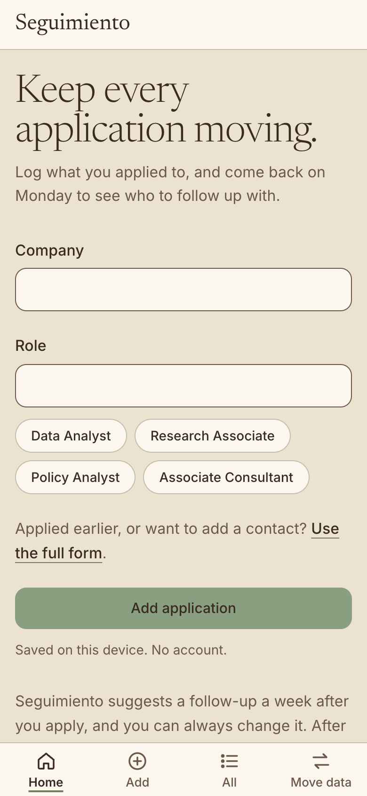

- **Expected:** a short explanation and a way to log a job.
- **Happened:** "Keep every application moving." with one line of explanation, then Company, Role, four role chips, "Use the full form" and **Add application**. Below the button: "Saved on this device. No account." The bottom bar has Home, Add, All and Move data.
- **Hesitated:** the goal has two parts, and the second is setting when to follow up. Nothing above the fold mentions follow-ups. The line that answers it ("Seguimiento suggests a follow-up a week after you apply, and you can always change it") sits below the Add button, off screen on a phone. "Applied earlier, or want to add a contact? Use the full form" made me wonder whether yesterday counts as "earlier".

### 2. Log the first job with quick add

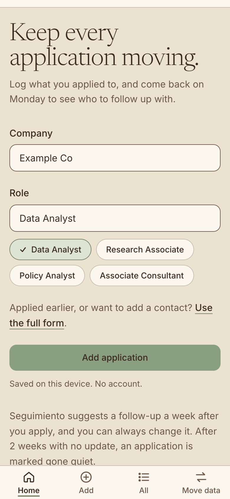 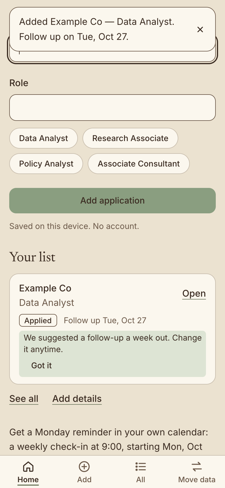

- **Expected:** type the company, pick or type the role, add it.
- **Happened:** typed "Example Co" and tapped the **Data Analyst** chip, which filled Role and showed as pressed. Then tapped **Add application**.
  - The toast said "Added Example Co — Data Analyst. Follow up on Tue, Oct 27."
  - "Your list" appeared with the job, an **Applied** badge, "Follow up Tue, Oct 27", and a tip: "We suggested a follow-up a week out. Change it anytime."
  - The form cleared, with the cursor back in Company.
- **Hesitated:** briefly. For about 5 seconds the toast sits over the Company field, where the cursor is. You can still tap and type through it, but you can't see what you type.

### 3. The mistake on purpose: second job, empty Role

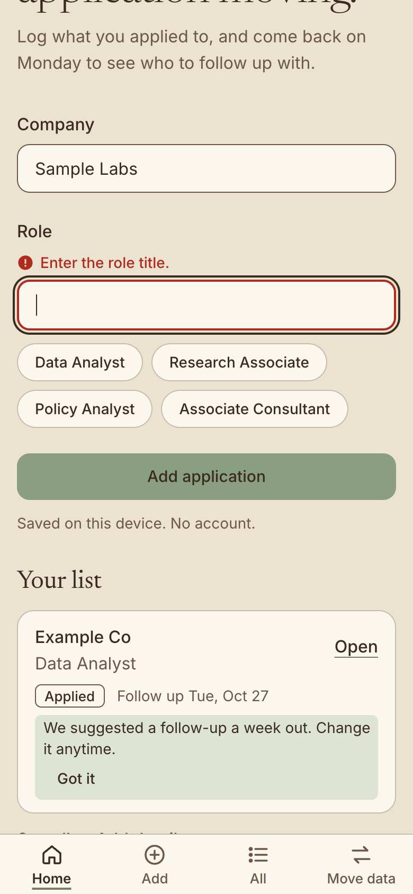

- **Expected:** an error that says what to do, without losing "Sample Labs".
- **Happened:** "Enter the role title." in red with an icon, right under the Role label. The field got a red edge, the cursor moved into Role, and "Sample Labs" was kept. The error cleared as soon as I typed "UX". I typed "UX Researcher" and pressed Enter (the phone keyboard's Go), and it was added: "Added Sample Labs — UX Researcher. Follow up on Tue, Oct 27."
- **Hesitated:** no.

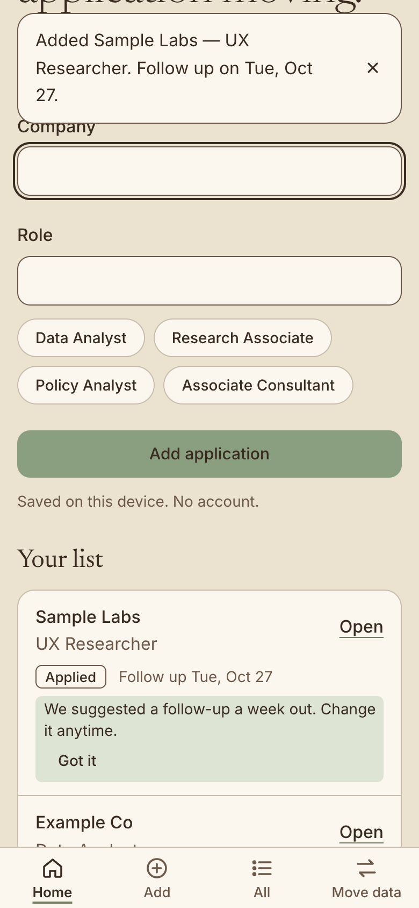

### 4. The third job was applied to yesterday

- **Expected:** a way to say "applied Monday". The first screen pointed at "Use the full form" for that.
- **Happened:** after the first add, that hint is gone. Below the list are only **See all** and **Add details**, and it's unclear whether "Add details" means this job or a new one. (It goes to the full Add form.) I tapped **Add** in the bottom bar, the obvious place.
- **Hesitated:** yes. I spent a moment looking for the "Use the full form" line from the first screen.

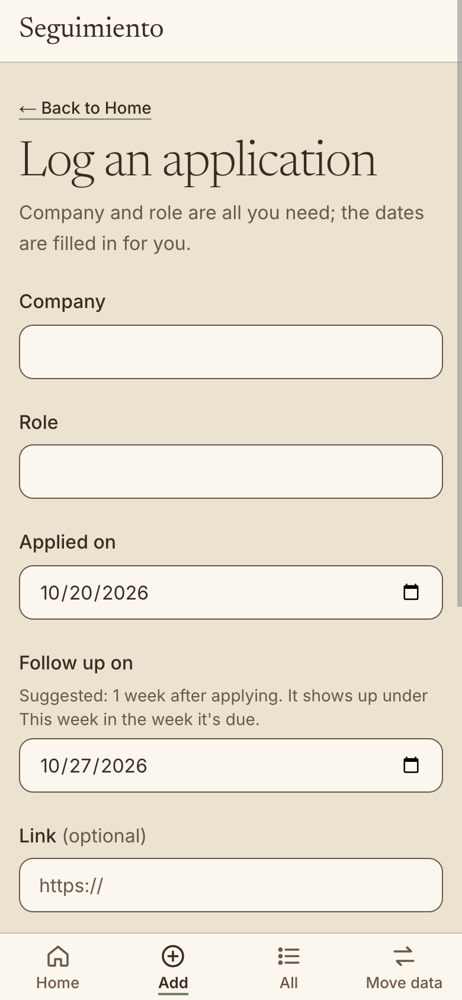

- **Happened on the form:** "Company and role are all you need; the dates are filled in for you." Applied on (today) and **Follow up on** (Oct 27) are both there, with the hint "Suggested: 1 week after applying."
  - I changed Applied on to Mon, Oct 19, and **Follow up on moved by itself to Mon, Oct 26.**
  - **Save application** took me to All applications. The new row was highlighted, the toast said "Added Placeholder Inc — Policy Analyst.", and the list was sorted soonest follow-up first.
- **Hesitated:** no. The one gap: this toast doesn't give the follow-up date, though quick add's toast does.

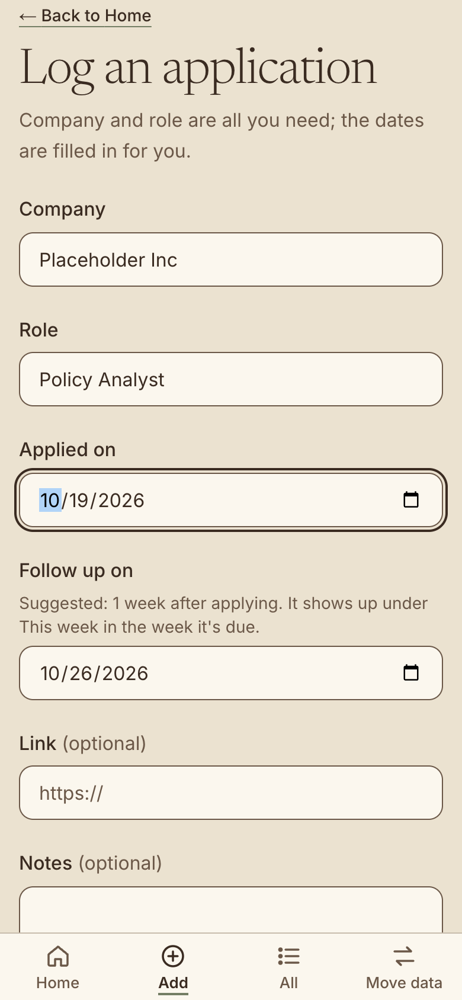 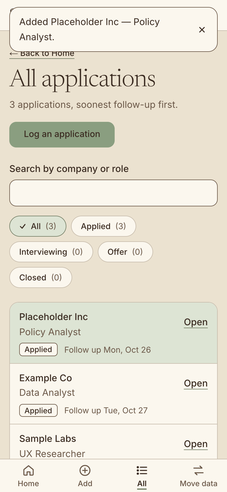

### 5. Set a follow-up date on purpose

The first two jobs got their follow-up dates automatically. To fully meet the goal, I set one myself: Sample Labs said they decide in two weeks, so the follow-up should be Tue, Nov 3. From All, I tapped **Open** on Sample Labs.

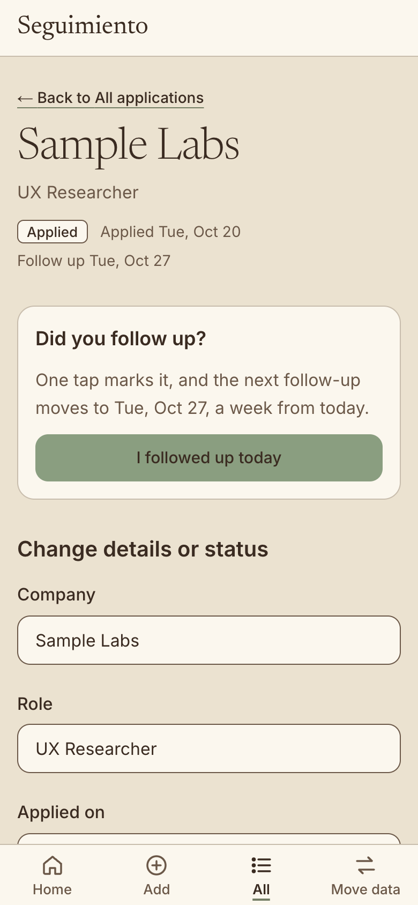

- **Expected:** the follow-up date, easy to change.
- **Happened:**
  - The header reads "Applied · Applied Tue, Oct 20 · Follow up Tue, Oct 27".
  - The first thing under it is a card, **"Did you follow up?"**, with the page's only green button: **I followed up today**. Its text reads "One tap marks it, and the next follow-up moves to Tue, Oct 27, a week from today."
  - **Follow up on** is the fifth field of "Change details or status" below. I changed it to Nov 3 and tapped **Save changes**. The toast said "Saved", and the header now reads "Follow up Tue, Nov 3".
- **Hesitated:** yes, the longest pause of the run.
  - I applied to this job *today*, yet the biggest action on its page asks whether I've already followed up. Someone who came here to *set* the follow-up could easily tap the green button.
  - The card promises to move the follow-up to Oct 27, which was already the date.
  - After I saved Nov 3, the card still offers to move it to Oct 27. One tap would quietly undo the date I just chose and mark the job Followed up.

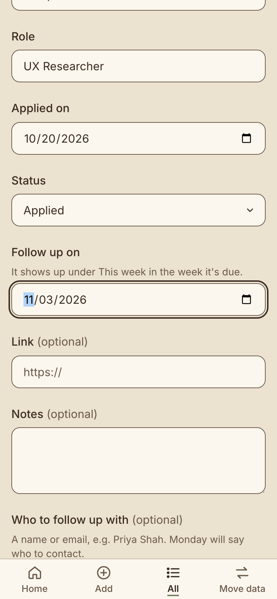 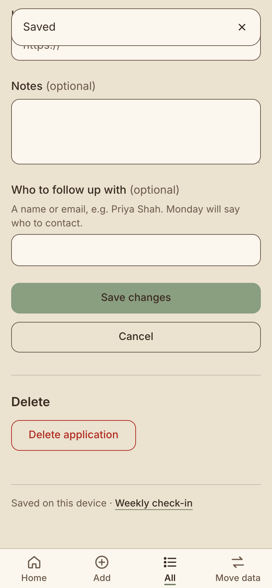

- **Also on this screen:** after Save changes the view stays at the bottom of the form, and the toast says only "Saved". The date I changed is off screen above, so nothing on screen confirms it.

## Day 2: coming back a week later (Tue, Oct 27)

### 6. Reopen the site

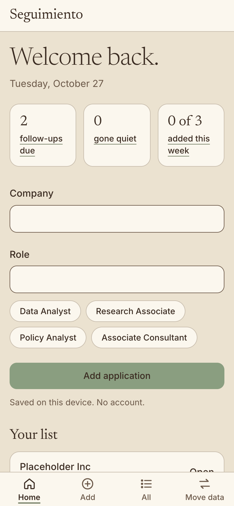

- **Expected:** to be told what needs doing.
- **Happened:** "Welcome back." with "Tuesday, October 27", then three numbers: **2 follow-ups due**, **0 gone quiet** and **0 of 3 added this week**. Quick add and Your list follow. All three jobs were still there after the browser restart.
- **Hesitated:** on the list, not on the numbers.

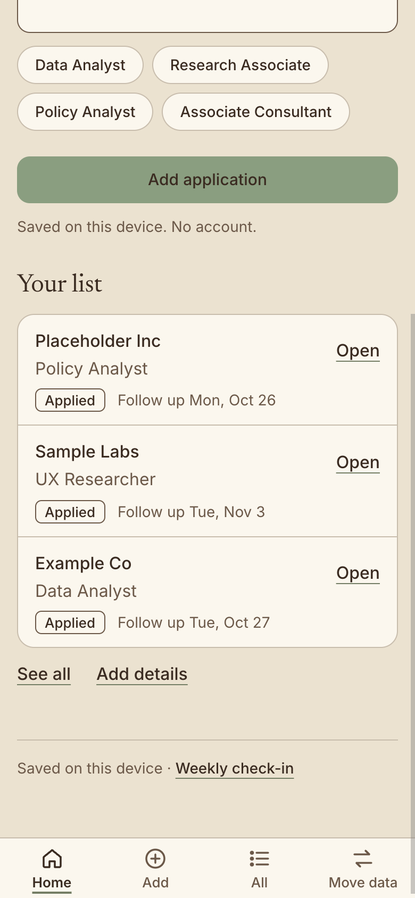

- "2 follow-ups due" doesn't say which two, and the list below doesn't either. Placeholder Inc is a day late (Oct 26) and Example Co is due today. Both look exactly like Sample Labs, which isn't due until Nov 3. The list is newest first, so the job due today is last.
- This was my first return, so there's no "Last check-in" line and no "Start your check-in?" prompt. The number link was the way in, and it worked.

### 7. The check-in

Tapped **2 follow-ups due**.

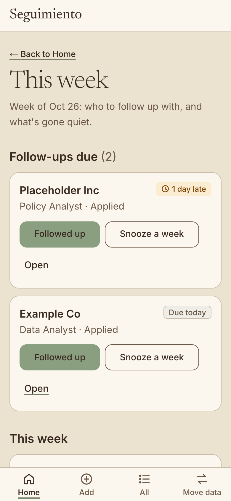

- **Expected:** the two due jobs, and a quick way to deal with each.
- **Happened:** "This week · Week of Oct 26". Then **Follow-ups due (2)** with one card per job: "1 day late" (clock icon) on Placeholder Inc and "Due today" on Example Co, each with **Followed up**, **Snooze a week** and **Open**.
- **Hesitated:** no. The clearest screen in the app.

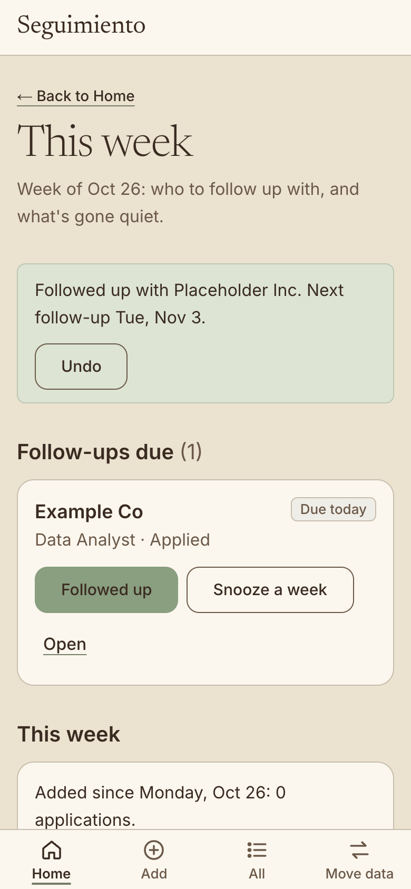 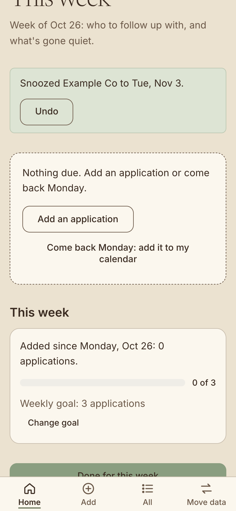

- **Followed up** on Placeholder Inc: "Followed up with Placeholder Inc. Next follow-up Tue, Nov 3." with **Undo**, and the card left the list.
- **Snooze a week** on Example Co: "Snoozed Example Co to Tue, Nov 3." with **Undo**. The list turned into "Nothing due. Add an application or come back Monday." with a calendar option.
- **Hesitated:** a little, on the "This week" card. It reads "Added since Monday, Oct 26: 0 applications. 0 of 3" against a weekly goal of 3 that I never set. The three jobs I logged last week don't count, so the check-in shows a bar at zero right after I cleared everything due. The page title is also "This week", so two headings share the name.

### 8. Finish

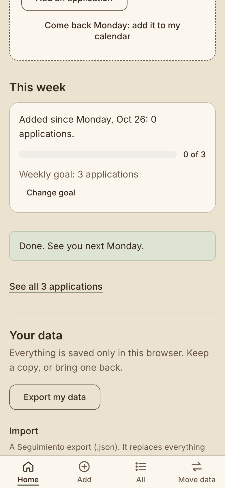 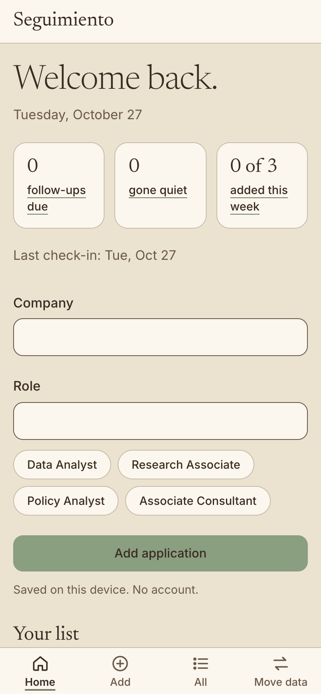

- **Happened:** **Done for this week** turned into "Done. See you next Monday.", and focus moved to it. Back on Home, the numbers read 0 due, 0 gone quiet and 0 of 3, with "Last check-in: Tue, Oct 27".
- **Saved data:** Example Co is still Applied, follow up Nov 3. Sample Labs is Applied, Nov 3. Placeholder Inc is Followed up, Nov 3.

## Usability problems, ranked by impact

| # | Impact | Problem | Proposed fix |
| --- | --- | --- | --- |
| 1 | **High** | On an application's page, **I followed up today** is the main green button even when nothing is due, including on a job applied today. It also ignores a date you chose: on Sample Labs, after I set Nov 3, one tap would move it back to Oct 27 and mark the job Followed up. ([09](screenshots/09-detail-sample-labs.png)) | Show "Did you follow up?" only when the follow-up is due or late, like the check-in does. Otherwise make it a quiet secondary action below the form. Never move a follow-up *earlier* without saying so: if the chosen date is later, say "Keeps Tue, Nov 3" or ask. |
| 2 | **Medium** | Home's "Your list" doesn't show which jobs are due. The number says "2 follow-ups due", but due-today, a day late and next week all look the same, and newest-first puts the due-today job last. ([13](screenshots/13-week-later-your-list.png)) | Use the same "Due today" and "1 day late" badges that All and the check-in already show, and sort due jobs first (or list soonest follow-up first, like All). |
| 3 | **Medium** | The follow-up date is hard to find on an application: it's the fifth field, below the fold, after the follow-up card. After saving, the view stays at the bottom and the toast says only "Saved". ([09](screenshots/09-detail-sample-labs.png), [11](screenshots/11-detail-saved.png)) | Give "Follow up Tue, Oct 27" in the header a **Change** button that jumps to the field, or move Follow up on up to sit after Status. Say what changed in the toast: "Saved. Follow up Tue, Nov 3." |
| 4 | **Medium** | Quick add has no applied date, and once you've added anything, the hint that points to the full form ("Applied earlier…? Use the full form") disappears. What's left, "Add details", is ambiguous. | Keep the "Applied earlier, or want to add a contact? Use the full form" line on returning Home too, or rename "Add details" to "Use the full form". |
| 5 | **Low** | On a phone, the toast covers the Company field for about 5 seconds after a quick add, right where the cursor is. Taps go through, but you can't see what you're typing. ([03](screenshots/03-job1-added.png)) | On the home page, offset the toast below the header and form, or don't send focus to Company until the toast is gone. Keep it at the top elsewhere. |
| 6 | **Low** | The first check-in shows "0 of 3" for a goal the person never set, counting only since Monday, so the week the jobs were actually logged doesn't show. The page title and that section heading are both "This week". ([17](screenshots/17-check-in-done.png)) | Until a goal is changed, word it as a suggestion ("Suggested goal: 3 a week. Change goal"). Rename the section heading, e.g. "Applications this week". |
| 7 | **Low** | The full form's toast ("Added Placeholder Inc — Policy Analyst.") leaves out the follow-up date that quick add's toast gives. | Use the same message in both places: "Added {Company} — {Role}. Follow up on {date}." |
| 8 | **Low (project rule)** | The contact field's hint gives "e.g. Priya Shah", a realistic person's name. AGENTS.md says sample content must be openly fictional. (`components/application-form.tsx`. Code comments also mention "Priya" and "Morningstar", a real company, though they never reach the screen.) | An openly fictional example, e.g. "e.g. Sam Example". |
| 9 | **Low** | Acting on two due jobs in a row leaves only the latest Undo. The first one's Undo disappears. ([16](screenshots/16-check-in-snoozed.png)) | Fine as is for a two-tap flow. If it matters, stack one line per action until Done. |

## Three things that worked

1. **The mistake cost nothing.** Submitting with an empty Role showed one clear sentence next to the field ("Enter the role title."), kept "Sample Labs", put the cursor in Role, and cleared the error as I typed. Enter submitted, as on any phone keyboard. ([04](screenshots/04-empty-role-error.png))
2. **Follow-ups set themselves, visibly.** Every job got a date a week out without being asked, and the date was said aloud: in the toast, on the row, and in a one-time tip that it can be changed. On the full form, changing Applied on moved Follow up on with it. ([03](screenshots/03-job1-added.png), [07](screenshots/07-add-applied-yesterday.png))
3. **The check-in is the best screen in the app.** A week later, the number on Home led straight to the two due jobs, each clearly late or due today. One tap dealt with each one and said the new date with an Undo, and Done closed the loop: "See you next Monday", and Home shows the last check-in. Nothing was lost across the browser restart. ([14](screenshots/14-check-in.png) to [18](screenshots/18-home-after-check-in.png))

## Not fixed yet

This is a report only, as asked. Nothing in the app was changed.
