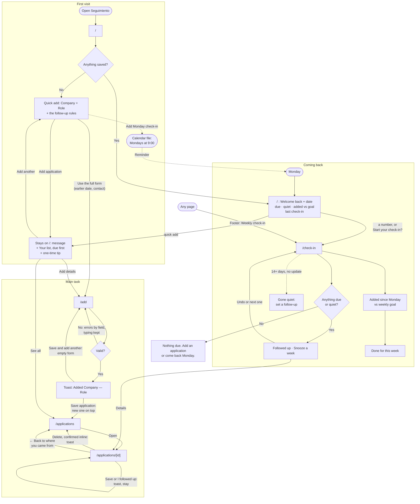

# Seguimiento: user flows

Seguimiento is a weekly ritual for one person: a second-year grad student applying to jobs in Chicago, usually in bursts between classes, on both a phone and a laptop. The main task in one sentence: I log an application, it goes on my list with a follow-up date, and when I come back on Monday it tells me who to follow up with.

Everything is saved in the browser's localStorage. There are no accounts, database or APIs. Every step is its own page, and the same navigation sits on all of them: **Home** (`/`), **Add** (`/add`), **All** (`/applications`) and **Move data** (`/move`). On a phone the navigation is a bar at the bottom with four labeled items, icon and word, within reach of a thumb, and no menu to open. On a laptop it sits in the header. Each application has its own page, `/applications/<id>`, reached from a list.

**Where you are and how to get back.** The current place in the navigation is marked for screen readers (`aria-current="page"`) and on screen: bold and underlined on a phone, bold on a tinted background on a laptop. An application's page marks All, and the check-in, reached from Home, marks Home. Every page starts with the same header: the title, one line on what the page is for, and, on every page but Home, a link that says where it goes, such as "← Back to All applications". It goes to the page you came from when that's known: the list (with its filter), Home or This week for an application, the list or Home for Add. Otherwise, as from a bookmark or the navigation, it goes to Home. At the bottom of every page, a footer says "Saved on this device" and links to the **Weekly check-in** (`/check-in`). Tab moves from top to bottom as the page is laid out: header, page, footer, then the phone's bottom bar.

Forms are one column with a label on every field. Errors appear when you save. Each one sits next to its field, says what to do next, and keeps what you typed.

## The follow-up rules

The follow-up date is filled in for you where a rule makes sense, and you can always change it:

- **Applied:** one week after the day you applied.
- **Followed up** (shown as Applied in the Status field): a week after the day you press Followed up.
- **Interviewing:** choosing it fills in three days from today. The interview date is optional.
- **Offer:** keeps the date it had. Answering the offer is the next step, so it still comes up in This week, but it never goes quiet.
- **Closed** (Rejected, Withdrawn or No response): there's no follow-up date.

On Add, the date follows Applied on until you type your own. After that, a suggestion appears under the field with a "Use" button, and the date only changes if you press it. On an application's page, choosing Interviewing fills in its date, and choosing another status right after puts the earlier date back.

An application that's Applied or Followed up goes quiet when its follow-up isn't due yet and there has been no update for 14 days. An update means applying, following up, a change of status, snoozing, or setting a follow-up date on the check-in; an interview still to come also counts. Interviewing and Offer don't go quiet, because they wait on a date you set.

## Flow 1: The first visit

You open Seguimiento for the first time, with nothing saved. For a moment, while the browser reads saved data, the page shows a neutral placeholder with no words in it. That way, someone who does have data never sees the empty screen flash first.

Then the page says what Seguimiento is for and lets you start right there. The heading is "Keep every application moving.", and one line under it says: log what you applied to, and come back on Monday to see who to follow up with. Below is a quick add with two fields, **Company** and **Role**. Both are marked required for screen readers. Under Role, chips offer roles you're likely to type: Data Analyst, Research Associate, Policy Analyst and Associate Consultant. Tapping one fills in Role and, if Company is still empty, moves you there; tapping it again clears Role. With a keyboard, the chips are one Tab stop and the arrow keys move between them. Before the button, a line links to the full Add form, for an application sent on an earlier day or one with a contact to follow up with, so it's read before an older application gets today's date. Under the button, a small line says "Saved on this device. No account." There's no tour, no pop-up and no sample data.

Pressing **Add application** with a field empty gives "Enter the company name." or "Enter the role title." next to the field, keeps what you typed, and moves you to the first one. A quick add saves today as the day you applied and a follow-up a week later. A short message says so ("Added Example Co — Data Analyst. Follow up on Tue, Oct 27."), announced politely to screen readers. On a phone it appears at the top of the screen, so it doesn't cover the new item below the form. You stay on the page: the form empties for the next one, and what you added appears below it under "Your list", each row with **Open**. Anything due comes first, soonest first, with the same words as the check-in ("Due today", "1 day late"); the rest follow, newest first. The list shows five; **See all** goes to the All page, and **Add details** opens the full Add form, so it's always within reach but never required.

Beside the newest item's follow-up date, a one-time tip says "We suggested a follow-up a week out. Change it anytime." It stays, visit after visit, until you press **Got it** or type a follow-up date of your own on Add or an application's page. Either one closes it for good on this device. The tip only appears beside a date Seguimiento suggested.

Before anything is saved, a line under the form states the rules: a follow-up a week after you apply, which you can always change, and after 2 weeks with no update, an application is marked gone quiet. Once the list appears, the tip does that job. The Monday calendar reminder is offered on the first visit and right after the first save.

**Coming back.** From the next visit on, once anything is saved, the headline is "Welcome back." with today's date ("Tuesday, October 20") instead of the first-visit line. (It's decided when the page opens, so saving your very first one doesn't make the page jump under your cursor.) Under it, three numbers, each a link: **follow-ups due** and **gone quiet** go to the check-in, and **added this week**, shown against the goal ("2 of 3"), goes to the list. Then, if you've done a check-in, "Last check-in: Tue, Oct 13", and once that's 7 or more days ago, one gentle line: "It's been a week. Start your check-in?" with a link. There's no modal, and the numbers use no alarm colors. Below that, the quick add stays, then Your list (due first, marked "Due today" or "1 day late", then the newest) and See all. `/` is always this page; the check-in lives at `/check-in`.

Seguimiento has no account, so it can't email anyone. Instead, the page offers **Add Monday check-in to my calendar**. It downloads `seguimiento-monday-check-in.ics`, a weekly event on Mondays at 9:00 starting next Monday, which the person adds to their own calendar. The page then says the file was downloaded and to open it. A last line, for someone who already uses Seguimiento on another device, links to loading a backup.

If the first save happens on the full Add page instead, a toast says "Added Example Co — Data Analyst." and the All page opens with the new application on top (see Flow 2). The Monday calendar reminder is on Home.

**Error: the browser won't save.** This happens in a private window, or when site data is blocked. A banner on every page says so: anything you add will be gone when you close the tab, so open Seguimiento in a regular window or allow this site to store data. The app still works for that tab, so you can see what it does.

## Flow 2: The main task (add, list, update)

**Add.** The Add page is one column, in this order: Company, Role, Applied on (today is filled in), Follow up on (a week later is filled in, and it follows Applied on until you type your own), then Link, Notes and Who to follow up with, all three optional. There's no status: a new application starts as Applied. Pressing **Save application** saves it, a toast says "Added Example Co — Data Analyst.", and the All page opens with the new application on top, highlighted for a few seconds and focused for keyboard and screen reader users. The list replaces the form in the browser's history, so **Back** goes to where you were before Add, not to a filled form. Because applications come in bursts, **Save and add another** saves, shows the same toast, and gives an empty form with the cursor in Company. What you type is kept as a draft as you go: leave Add by mistake (a tap on the nav, a closed tab) and coming back restores it, with a small "Restored your draft" line and **Start over**. Saving clears the draft.

**Errors when adding.** Fields are checked when you save, after spaces at either end are removed (and, in single-line fields, runs of spaces inside become one), so "  Example   Co " is saved as "Example Co" and a field of only spaces counts as empty. Every problem is shown at once, next to its field, what you typed stays, and the cursor moves to the first one. From then on, a field with an error is checked again as you change it: the error goes as soon as it's fixed, and fixing Applied on can also clear Follow up on.

- An empty company: "Enter the company name."
- An empty role: "Enter the role title."
- A company or role over 80 characters: "Shorten the company name to 80 characters or fewer." / "Shorten the role title to 80 characters or fewer."
- Notes over 1,000 characters: "Shorten the notes to 1,000 characters or fewer."
- Applied on empty or not a date: "Enter the date you applied."
- Applied on in the future: "Choose today or an earlier date."
- A follow-up date before Applied on: "Choose a follow-up date on or after the application date."
- A link that doesn't start with http:// or https://: "Enter a full link starting with https://, or leave it blank."

**Limits.** Company and role take up to 80 characters, notes up to 1,000. From 80% of the limit, a counter under the field says how many are left ("12 characters left"), and past it, in red, how many too many. Typing or pasting past the limit isn't cut off; saving shows the error. In lists, a long company or role ends with "…" after two lines.

**Duplicates.** On Add and the quick add, as soon as the company and role match a saved application (ignoring case and extra spaces), a notice appears under Company: "You already have Example Co — Data Analyst." It's a notice, not an error, so saving still works. **Open it** goes to the saved one; **Add anyway** puts the notice away for that company and role and moves on to Role. On an application's page, the same notice appears only if you change the company or role to match another one, with **Keep both**.

If the browser refuses to save, usually because its storage is full, a message above the button says so. The form stays filled in so you can try again.

**List.** The All page shows every application as one list, sorted by follow-up date, soonest first, with those without a follow-up date last. Each row shows the company, role, status and follow-up date, and an **Open** link. Late ones also say "7 days late" with a clock icon, and gone-quiet ones "No update for 20 days", so nothing depends on color alone. At the top, a search field labelled "Search by company or role" narrows the list as you type, and filter chips (All, Applied, Interviewing, Offer, Closed) show how many each holds. Followed up counts as Applied; Rejected, Withdrawn and No response count as Closed. The chosen filter is in the address (`?status=offer`), so Back and a shared link keep it, and it's remembered: opening All later shows the chip you chose last. Pressing the chip that's on goes back to All, which forgets it. Right after Add, the list shows All so the new one is in view. While filtering or searching, a line says "Showing 3 of 5."

**Never a blank page.** With nothing saved, the page says "Nothing logged yet" and offers **Log your first application**, which goes to Home. A filter with nothing in it says so in one sentence ("No offers yet.") with a link, **Show all applications**. A search with no results says "Nothing matches “zzz”." with **Clear search**, which puts the cursor back in the search field. After you add one, it sits on top, highlighted for a few seconds.

**One application.** Open on any list goes to the application's own page. At the top, what's saved: company, role, status, the day you applied and the next follow-up. Once the follow-up is due, a card asks **Did you follow up?** with **I followed up today**, which moves the next follow-up a week out in one tap and says so in a toast. Before it's due, the same button is a quiet "Followed up early?" line instead, so a just-added application doesn't open on that question. Following up never pulls a later date you chose earlier. An application that's Interviewing or has an offer keeps its status. Below it, every field, with the same fields and rules as Add, plus **Status**: Applied, Interviewing, Offer or Closed. Choosing Closed asks **Why it closed** (Rejected, Withdrawn or No response) and hides the follow-up date. **Change**, beside the follow-up date at the top, goes straight to that field. **Save changes** stays on the page and says "Saved. Follow up Tue, Nov 3." in a toast, since the field is usually out of view by then. **Delete application** asks first, on the page, not in a browser dialog: it says it can't be undone and that closing keeps the record instead. **Delete it** goes to the list with "Deleted Example Co — Data Analyst." in a toast, and **Keep it** puts you back on Delete application. The list replaces the page in the history, so Back can't open what was deleted.

**Errors on an application's page.** The same errors as Add, plus "Choose why it closed." when Closed has no reason, and "Pick a follow-up date." when a reopened application has none. An interview date, if given, can't be before the day you applied. If the address doesn't match anything saved here, perhaps because it was deleted or saved in another browser, the page says "This application isn't on this device." with a link to all applications.

## Flow 3: Coming back (the Monday check-in)

The check-in is the reason to come back. It lives at `/check-in`, reached from Home's numbers, the "Start your check-in?" line, and every page's footer. It works on any day, but it's built for Monday. It opens with "Week of Oct 19", and every decision can be made right there without opening each application. Four parts, in this order:

**1. Follow-ups due.** Every open application (Applied, Followed up, Interviewing or Offer) whose follow-up date is today or earlier, soonest first. Each one names the person when you gave one ("Follow up with Priya at Example Co"), shows the role and status, and says how late it is ("7 days late", "Due today"). Each has three actions:
- **Followed up** moves the next follow-up to a week from today. Applied becomes Followed up; Interviewing and Offer keep their status.
- **Snooze a week** moves it to a week from today. A week after the old date could still be in the past for a late one.
- **Open** goes to the application's page.

**2. Gone quiet.** Applied or Followed up applications that aren't due but have had no update for 2 weeks or more, the quietest first, with "No update for 20 days". **Set a follow-up** opens a date field right there, with a week from today filled in. Saving gives it that date, so it leaves Gone quiet and comes back under Follow-ups due on that day. An empty date gives "Pick a follow-up date." and a past one "Choose today or a later date." Cancel puts you back on the button.

After any of these, a message says what happened ("Followed up with Example Co. Next follow-up Tue, Oct 27."), with **Undo** in case of a wrong tap on a phone.

**Nothing to do.** When nothing is due and nothing is quiet, the page says so plainly: "Nothing due. Add an application or come back Monday." It offers **Add an application** and **Come back Monday: add it to my calendar**, which downloads the Monday reminder.

**3. This week.** "Added since Monday, Oct 19: 2 applications." A bar shows that against the weekly goal, with "2 of 3" beside it, and "Goal met." once it's reached. The goal is 3 to start. **Change goal** opens a field in place: a whole number from 1 to 20, or "Enter a whole number from 1 to 20." It's saved in this device's settings.

**4. Done for this week.** The main button saves today as the last check-in and says "Done. See you next Monday." It keeps saying so for the rest of the week.

**Your data**, at the foot of the page, is the safety net:
- **Export my data** downloads everything, applications and settings, as `seguimiento-2026-10-20.json`.
- **Import** is a labelled file field with **Check the file**. With no file: "Choose a Seguimiento export." A file that isn't valid JSON, isn't marked as Seguimiento's, or has a damaged application: "Couldn't read that file. Choose a Seguimiento export." Nothing changes in either case.
- **A good file** opens a confirmation right there: "Replace everything on this device? The file has 2 applications, exported Tue, Oct 20. The 7 applications here now, your weekly goal and last check-in will be replaced. This can't be undone, so export first if you want a copy." **Replace my data** swaps it in and says "Imported."; **Cancel** clears the file.
- An older backup without settings replaces the applications and keeps this device's settings. To merge instead of replace, the hint points to Move data.

**Other states.** The page shows a neutral placeholder while loading, and the first-visit page when nothing is saved. When the saved data is damaged and can't be read, a banner on every page explains it. The damaged copy is set aside under another key, the list continues with whatever could be read, and the banner points to loading a backup. If the browser refuses to save Followed up, Snooze a week or a follow-up date, the message says the change couldn't be saved; if it refuses Done for this week or the goal, an error says so next to it. If it refuses an Undo, the message says the change is still saved and keeps the Undo button so you can try again.

## Moving between devices

localStorage stays in one browser, so the phone and the laptop each have their own list. Move data connects them with a file. On one device, **Download backup** saves `seguimiento-2026-10-19.json`. On the other, you choose that file and press **Check the file**. Before anything changes, Seguimiento says what loading it would do: "This backup has 15 applications. Loading it adds 3 and updates 2. Nothing is deleted." **Combine** then merges the two lists. When both devices changed the same application, the more recent change wins. When it's done, the page says how many applications are on this device and offers See this week. If the two already match, the page says there's nothing to combine.

**Errors.** Pressing Check the file with no file chosen gives "Choose the .json file you downloaded from Seguimiento." A file that isn't a Seguimiento backup, or is damaged, gives "This file isn't a Seguimiento backup. Download a new one on your other device and try again." If saving the combined list fails, nothing changes and the page says so. A device with nothing saved says there's nothing to download yet, instead of offering an empty file.

## Cut for simplicity

- **Tags:** status and the search by company or role are enough to find an application among a few dozen.
- **A separate contacts list:** one optional "who to follow up with" field per application is enough to say "Email Priya at Morningstar."
- **Weekly stats** ("you logged 4, followed up 2"): they're nice to see but don't help decide who to contact.
- **Syncing between open tabs:** it's one person in one tab at a time, and each page reads fresh data when opened.
- **Recovering damaged saved data:** the raw copy is kept under another key and the list carries on, which is enough for a rare problem.
- **Example data on the first visit:** the quick add puts your own first application on the page within seconds, so there's nothing to clear later.
- **Automatic sync and backup reminders:** there's no server to sync through, and a reminder would need one more thing to track.
- **Undoing a combine:** the summary before confirming and the "nothing is deleted" rule make it safe without one.
- **One-week and two-week buttons on the follow-up date:** the rule already fills in the date, and the "Use" suggestion covers changing it, with fewer buttons on a phone.
