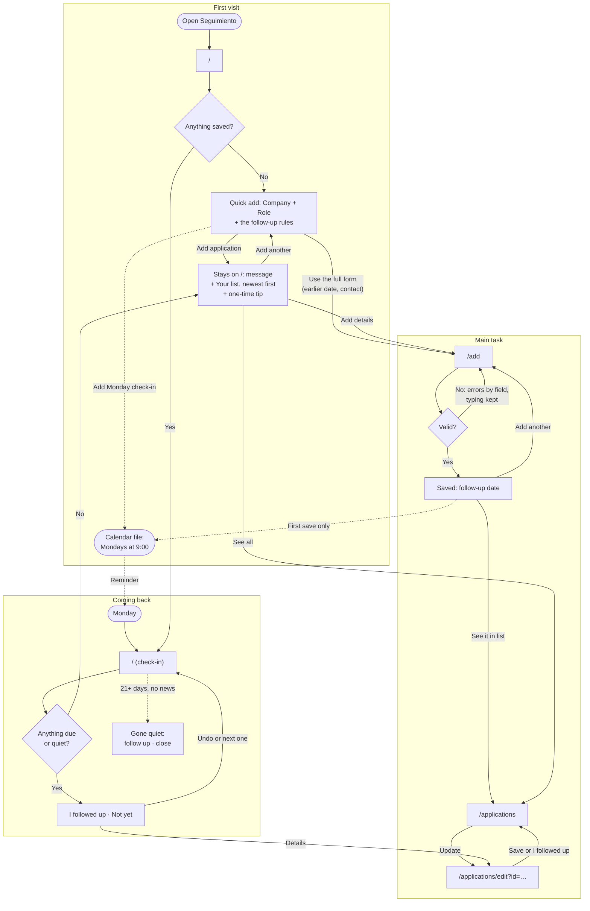

# Seguimiento: user flows

Seguimiento is a weekly ritual for one person: a second-year grad student applying to jobs in Chicago, usually in bursts between classes, on both a phone and a laptop. The main task in one sentence: I log an application, it goes on my list with a follow-up date, and when I come back on Monday it tells me who to follow up with.

Everything is saved in the browser's localStorage. There are no accounts, database or APIs. Every step is its own page, and the same navigation sits on all of them: **Home** (`/`), **Add** (`/add`), **All** (`/applications`) and **Move data** (`/move`). On a phone the navigation is a bar at the bottom, within reach of a thumb. On a laptop it sits in the header. Updating one application happens on its own page, `/applications/edit`, reached from a list.

Forms are one column with a label on every field. Errors appear when you save. Each one sits next to its field, says what to do next, and keeps what you typed.

## The follow-up rules

The follow-up date is always filled in for you, and you can always change it. It depends on the status:

- **Applied:** one week after the day you applied.
- **Followed up:** two weeks after today.
- **Interviewing:** the form asks for the interview date and suggests three days after it.
- **Closed** (Offer, Rejected, Withdrawn or No response): there's no follow-up date.

The date follows the rule until you type your own. After that, changing the status or another date doesn't overwrite yours. A suggestion appears under the field with a "Use" button, and the date only changes if you press it.

An open application goes quiet when there has been no news for 21 days. News means applying, following up or a change of status; an interview still to come also counts. Pressing "Not yet" isn't news, so an application you keep postponing still goes quiet on schedule.

## Flow 1: The first visit

You open Seguimiento for the first time, with nothing saved. For a moment, while the browser reads saved data, the page shows a neutral placeholder with no words in it. That way, someone who does have data never sees the empty screen flash first.

Then the page says what Seguimiento is for and lets you start right there. The heading is "Keep every application moving.", and one line under it says: log what you applied to, and come back on Monday to see who to follow up with. Below is a quick add with two fields, **Company** and **Role**. Both are marked required for screen readers. Under Role, chips offer roles you're likely to type: Data Analyst, Research Associate, Policy Analyst and Associate Consultant. Tapping one fills in Role and, if Company is still empty, moves you there; tapping it again clears Role. With a keyboard, the chips are one Tab stop and the arrow keys move between them. Before the button, a line links to the full Add form, for an application sent on an earlier day or one with a contact to follow up with, so it's read before an older application gets today's date. Under the button, a small line says "Saved on this device. No account." There's no tour, no pop-up and no sample data.

Pressing **Add application** with a field empty gives "Enter the company name." or "Enter the role title." next to the field, keeps what you typed, and moves you to the first one. A quick add saves today as the day you applied and a follow-up a week later. A short message says so ("Added Example Co — Data Analyst. Follow up on Tue, Oct 27."), announced politely to screen readers. On a phone it appears at the top of the screen, so it doesn't cover the new item below the form. You stay on the page: the form empties for the next one, and what you added appears below it under "Your list", newest first, each row with **Open**. The list shows the newest five; **See all** goes to the All page, and **Add details** opens the full Add form, so it's always within reach but never required.

Beside the newest item's follow-up date, a one-time tip says "We suggested a follow-up a week out. Change it anytime." It stays, visit after visit, until you press **Got it** or type a follow-up date of your own on Add or Update. Either one closes it for good on this device. The tip only appears beside a date Seguimiento suggested.

Before anything is saved, a line under the form states the rules: a follow-up a week after you apply, which you can always change, and after 3 weeks with no news, an application is marked gone quiet. Once the list appears, the tip does that job. The Monday calendar reminder is offered on the first visit and right after the first save.

`/` stays like this, the quick add and your newest applications, while nothing is due or gone quiet. When a follow-up comes up, `/` becomes the This week check-in below.

Seguimiento has no account, so it can't email anyone. Instead, the page offers **Add Monday check-in to my calendar**. It downloads `seguimiento-monday-check-in.ics`, a weekly event on Mondays at 9:00 starting next Monday, which the person adds to their own calendar. The page then says the file was downloaded and to open it. A last line, for someone who already uses Seguimiento on another device, links to loading a backup.

If the first save happens on the full Add page instead, it says when the follow-up is ("Saved. Follow up with Priya at Morningstar on Mon, Oct 26"). When an application sent a while ago is already due, it says so instead: "It's on This week now, ready to follow up." From there you can add another or go to This week. After the very first save only, the Monday calendar reminder is offered again. Your first visit ends with a date to come back to, and a way to be reminded of it.

**Error: the browser won't save.** This happens in a private window, or when site data is blocked. A banner on every page says so: anything you add will be gone when you close the tab, so open Seguimiento in a regular window or allow this site to store data. The app still works for that tab, so you can see what it does.

## Flow 2: The main task (add, list, update)

**Add.** The Add page is one column, in this order: Company, Role, Applied on (today is filled in), Follow up on (a week later is filled in, and it follows Applied on until you type your own), then Link, Notes and Who to follow up with, all three optional. There's no status: a new application starts as Applied. Pressing **Save application** saves it. The page then confirms the follow-up date and offers **Add another** first, because applications come in bursts. Add another clears the form and puts the cursor back in Company. **Go to Home** and **See it in your list** are the other ways out. While the form is being checked, a valid application is also logged to the browser console.

**Errors when adding.** Fields are checked when you save. Every problem is shown at once, next to its field, what you typed stays, and the cursor moves to the first one. From then on, a field with an error is checked again as you change it: the error goes as soon as it's fixed, and fixing Applied on can also clear Follow up on.

- An empty company: "Enter the company name."
- An empty role: "Enter the role title."
- Applied on empty or not a date: "Enter the date you applied."
- Applied on in the future: "Choose today or an earlier date."
- A follow-up date before Applied on: "Choose a follow-up date on or after the application date."
- A link that doesn't start with http:// or https://: "Enter a full link starting with https://, or leave it blank."

Logging the same company and role twice is a warning, not an error: "You already logged Data Analyst at Morningstar on Oct 3." It offers **Save anyway** or **Open that one**. If the browser refuses to save, usually because its storage is full, a message above the button says so. The form stays filled in so you can try again.

**List.** The All page shows every application, sorted by follow-up date, in the order you'd act on them: Due this week (late ones first), Upcoming, Gone quiet, and Closed (folded away). Each row shows the company, role and status, a tag saying when (such as "4 days late", "Follow up Thu, Oct 22" or "No news for 26 days"), and an **Update** link. After you add or change one, the page says what happened and marks that row "Just changed". Late items carry a clock icon and the words "days late", so nothing depends on color alone. With nothing saved, the page explains what will appear there and offers Log an application.

**Update.** The Update page leads with the most common change. **I followed up today** marks the application as Followed up and moves the next follow-up two weeks out, in one tap. An application that's Interviewing stays Interviewing. Below it is the same form as Add, plus the status: Applied, Followed up and Interviewing, then the closed ones, Offer, Rejected, Withdrawn and No response. Choosing Interviewing adds the interview date. Choosing a closed status hides the follow-up date. Saving takes you back to the page you came from, which says what changed ("Updated Morningstar. Next follow-up Mon, Nov 2"). **Delete application** asks first, says it can't be undone, and points out that a closed status keeps the record instead.

**Errors when updating.** The form has the same errors as Add, plus one more: when the interview date is missing, "Enter the interview date. A best guess is fine; you can change it later." If the application can't be found, it may have been deleted or saved in another browser. The page says so and links back to the list and to Move data.

## Flow 3: Coming back (the Monday check-in)

Once something is due or gone quiet, Home is the This week check-in. It works on any day, but it's built for Monday. It opens with "Week of Oct 19" and then shows only what needs a decision. Every decision can be made on that page without opening each application.

**Follow-ups due.** "Follow up this week" lists everything due by Sunday, late ones first. Each item names the person when you gave one ("Follow up with Priya at Morningstar"), shows the role and status, and says when it was due ("4 days late", "Due today", "Due Thu, Oct 22"). Each one has **I followed up** (the next date moves two weeks out), **Not yet** (asks again in a week) and **Details**.

**Applications gone quiet.** "Gone quiet" lists open applications with no news in three weeks or more, the quietest first, with how long it has been. Each one has **Follow up once more** or **Close it**, which closes it as No response.

After any of these actions, a message says what happened ("Followed up with Morningstar. Next follow-up Sun, Nov 1"), with an **Undo** in case of a wrong tap on a phone.

**All caught up.** When nothing is due or quiet, `/` goes back to the quick add and your newest applications (see Flow 1). Right after you handle the last due one, the check-in stays while its message and **Undo** are showing, and says what's next: "Nothing due this week. Next: Grubhub on Thu, Oct 29 (in 11 days)".

**Everything closed.** When every application is closed, nothing is due, so `/` shows the quick add and your newest applications.

**Other states.** The page shows a neutral placeholder while loading, and the first-visit page when nothing is saved. When the saved data is damaged and can't be read, a banner on every page explains it. The damaged copy is set aside under another key, the list continues with whatever could be read, and the banner points to loading a backup. If the browser refuses to save "I followed up", "Not yet", "Follow up once more" or "Close it", the message says the change couldn't be saved. If it refuses an Undo, the message says the change is still saved and keeps the Undo button so you can try again.

## Moving between devices

localStorage stays in one browser, so the phone and the laptop each have their own list. Move data connects them with a file. On one device, **Download backup** saves `seguimiento-2026-10-19.json`. On the other, you choose that file and press **Check the file**. Before anything changes, Seguimiento says what loading it would do: "This backup has 15 applications. Loading it adds 3 and updates 2. Nothing is deleted." **Combine** then merges the two lists. When both devices changed the same application, the more recent change wins. When it's done, the page says how many applications are on this device and offers See this week. If the two already match, the page says there's nothing to combine.

**Errors.** Pressing Check the file with no file chosen gives "Choose the .json file you downloaded from Seguimiento." A file that isn't a Seguimiento backup, or is damaged, gives "This file isn't a Seguimiento backup. Download a new one on your other device and try again." If saving the combined list fails, nothing changes and the page says so. A device with nothing saved says there's nothing to download yet, instead of offering an empty file.

## Cut for simplicity

- **Saving a half-finished form automatically:** the form is short, and errors already keep what you typed.
- **Search, filters and tags:** the list is sorted by what to do next, and a few dozen applications don't need searching.
- **A separate contacts list:** one optional "who to follow up with" field per application is enough to say "Email Priya at Morningstar."
- **Weekly stats** ("you logged 4, followed up 2"): they're nice to see but don't help decide who to contact.
- **Syncing between open tabs:** it's one person in one tab at a time, and each page reads fresh data when opened.
- **Recovering damaged saved data:** the raw copy is kept under another key and the list carries on, which is enough for a rare problem.
- **Example data on the first visit:** the quick add puts your own first application on the page within seconds, so there's nothing to clear later.
- **Automatic sync and backup reminders:** there's no server to sync through, and a reminder would need one more thing to track.
- **Undoing a combine:** the summary before confirming and the "nothing is deleted" rule make it safe without one.
- **One-week and two-week buttons on the follow-up date:** the rule already fills in the date, and the "Use" suggestion covers changing it, with fewer buttons on a phone.
