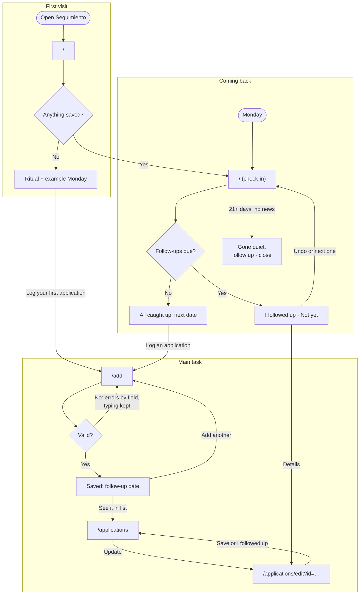

# Seguimiento: user flows

Seguimiento is a weekly ritual for one person: a second-year grad student applying to jobs in Chicago, usually in bursts between classes, on both a phone and a laptop. The main task in one sentence: I log an application, it goes on my list with a follow-up date, and when I come back on Monday it tells me who to follow up with.

Everything is saved in the browser's localStorage. There are no accounts, database or APIs. Every step is its own page, and the same navigation sits on all of them: **This week** (`/`), **Add** (`/add`), **All** (`/applications`) and **Move data** (`/move`). On a phone the navigation is a bar at the bottom, within reach of a thumb. On a laptop it sits in the header. Updating one application happens on its own page, `/applications/edit`, reached from a list.

Forms are one column with a label on every field. Errors appear when you save. Each one sits next to its field, says what to do next, and keeps what you typed.

## The follow-up rules

The follow-up date is always filled in for you, and you can always change it. It depends on the status:

- **Applied:** one week after the day you applied.
- **Followed up:** two weeks after today.
- **Interviewing:** the form asks for the interview date and suggests three days after it.
- **Closed** (Offer, Rejected, Withdrawn or No response): there's no follow-up date.

The date follows the rule until you type your own. After that, changing the status or another date doesn't overwrite yours. A suggestion appears under the field with a "Use" button, and the date only changes if you press it.

An open application goes quiet when there has been no news for 21 days. News means applying, following up or a change of status; an interview still to come also counts. Pressing "Not yet" isn't news, so an application you keep postponing still goes quiet on schedule.

## Flow 1: The first visit

You open Seguimiento for the first time, with nothing saved. For a moment, while the browser reads saved data, the page shows a neutral placeholder with no words in it. That way, someone who does have data never sees the empty screen flash first.

Then the page shows what the ritual is and where it leads, instead of an empty list. A heading and one line explain it: log each application as you send it, Seguimiento picks a follow-up date, and on Monday it tells you who to follow up with. One main button, **Log your first application**, opens the Add page. Below it, a clearly labeled example shows what a Monday looks like: "Email Priya at Morningstar, 2 days late" and "Grubhub, due Thursday". The example isn't data, and nothing has to be cleared later. A last line, for someone who already uses Seguimiento on another device, links to loading a backup.

After the first save, the Add page says when the follow-up is ("Saved. Follow up with Priya at Morningstar on Mon, Oct 26"). From there you can add another or go to This week. Your first visit ends with a date to come back to.

**Error: the browser won't save.** This happens in a private window, or when site data is blocked. A banner on every page says so: anything you add will be gone when you close the tab, so open Seguimiento in a regular window or allow this site to store data. The app still works for that tab, so you can see what it does.

## Flow 2: The main task (add, list, update)

**Add.** The Add page asks for the company, the role, the date applied (today is filled in) and the follow-up date (a week later is filled in). Who to follow up with, the link to the job posting and notes are optional, folded under "More details" so the form fits on a phone screen. Pressing **Save application** saves it. The page then confirms the follow-up date and offers **Add another** first, because applications come in bursts. Add another clears the form and puts the cursor back in Company. **See this week** and **See it in your list** are the other ways out.

**Errors when adding.** When you save, every problem is shown at once, next to its field, and the cursor moves to the first one. If that field is under More details, the section opens.

- An empty company: "Enter the company name, e.g. Morningstar."
- An empty role: "Enter the role, e.g. Data Analyst."
- A date applied in the future: "Pick today or an earlier date."
- A follow-up date before the date applied: "Pick a date on or after Oct 14, the day you applied."
- A link that isn't a web address: "Paste the full link, starting with https://."

Logging the same company and role twice is a warning, not an error: "You already logged Data Analyst at Morningstar on Oct 3." It offers **Save anyway** or **Open that one**. If the browser refuses to save, usually because its storage is full, a message above the button says so. The form stays filled in so you can try again.

**List.** The All page shows every application, sorted by follow-up date, in the order you'd act on them: Due this week (late ones first), Upcoming, Gone quiet, and Closed (folded away). Each row shows the company, role and status, a tag saying when (such as "4 days late", "Follow up Thu, Oct 22" or "No news for 26 days"), and an **Update** link. After you add or change one, the page says what happened and marks that row "Just changed". Late items carry a clock icon and the words "days late", so nothing depends on color alone. With nothing saved, the page explains what will appear there and offers Log an application.

**Update.** The Update page leads with the most common change. **I followed up today** marks the application as Followed up and moves the next follow-up two weeks out, in one tap. An application that's Interviewing stays Interviewing. Below it is the same form as Add, plus the status: Applied, Followed up and Interviewing, then the closed ones, Offer, Rejected, Withdrawn and No response. Choosing Interviewing adds the interview date. Choosing a closed status hides the follow-up date. Saving takes you back to the page you came from, which says what changed ("Updated Morningstar. Next follow-up Mon, Nov 2"). **Delete application** asks first, says it can't be undone, and points out that a closed status keeps the record instead.

**Errors when updating.** The form has the same errors as Add, plus one more: when the interview date is missing, "Enter the interview date. A best guess is fine; you can change it later." If the application can't be found, it may have been deleted or saved in another browser. The page says so and links back to the list and to Move data.

## Flow 3: Coming back (the Monday check-in)

This week is the home page. It works on any day, but it's built for Monday. It opens with "Week of Oct 19" and then shows only what needs a decision. Every decision can be made on that page without opening each application.

**Follow-ups due.** "Follow up this week" lists everything due by Sunday, late ones first. Each item names the person when you gave one ("Follow up with Priya at Morningstar"), shows the role and status, and says when it was due ("4 days late", "Due today", "Due Thu, Oct 22"). Each one has **I followed up** (the next date moves two weeks out), **Not yet** (asks again in a week) and **Details**.

**Applications gone quiet.** "Gone quiet" lists open applications with no news in three weeks or more, the quietest first, with how long it has been. Each one has **Follow up once more** or **Close it**, which closes it as No response.

After any of these actions, a message says what happened ("Followed up with Morningstar. Next follow-up Sun, Nov 1"), with an **Undo** in case of a wrong tap on a phone.

**All caught up.** When nothing is due or quiet, the page says so and tells you what's next: "Nothing due this week. Next: Grubhub on Thu, Oct 29 (in 11 days)". It also offers Log an application.

**Everything closed.** When every application is closed, the page says there are no open applications and offers to log a new one.

**Other states.** The page shows a neutral placeholder while loading, and the first-visit page when nothing is saved. When the saved data is damaged and can't be read, a banner on every page explains it. The damaged copy is set aside under another key, the list continues with whatever could be read, and the banner points to loading a backup. If the browser refuses to save "I followed up", "Not yet", "Follow up once more" or "Close it", the message says the change couldn't be saved.

## Moving between devices

localStorage stays in one browser, so the phone and the laptop each have their own list. Move data connects them with a file. On one device, **Download backup** saves `seguimiento-2026-10-19.json`. On the other, you choose that file and press **Check the file**. Before anything changes, Seguimiento says what loading it would do: "This backup has 15 applications. Loading it adds 3 and updates 2. Nothing is deleted." **Combine** then merges the two lists. When both devices changed the same application, the more recent change wins. When it's done, the page says how many applications are on this device and offers See this week. If the two already match, the page says there's nothing to combine.

**Errors.** Pressing Check the file with no file chosen gives "Choose the .json file you downloaded from Seguimiento." A file that isn't a Seguimiento backup, or is damaged, gives "This file isn't a Seguimiento backup. Download a new one on your other device and try again." If saving the combined list fails, nothing changes and the page says so. A device with nothing saved says there's nothing to download yet, instead of offering an empty file.

## Cut for simplicity

- **Saving a half-finished form automatically:** the form is short, and errors already keep what you typed.
- **Search, filters and tags:** the list is sorted by what to do next, and a few dozen applications don't need searching.
- **A separate contacts list:** one optional "who to follow up with" field per application is enough to say "Email Priya at Morningstar."
- **Weekly stats** ("you logged 4, followed up 2"): they're nice to see but don't help decide who to contact.
- **Syncing between open tabs:** it's one person in one tab at a time, and each page reads fresh data when opened.
- **Recovering damaged saved data:** the raw copy is kept under another key and the list carries on, which is enough for a rare problem.
- **Example data on the first visit:** a labeled picture of a Monday shows the same thing without data that has to be cleared later.
- **Automatic sync and backup reminders:** there's no server to sync through, and a reminder would need one more thing to track.
- **Undoing a combine:** the summary before confirming and the "nothing is deleted" rule make it safe without one.
- **One-week and two-week buttons on the follow-up date:** the rule already fills in the date, and the "Use" suggestion covers changing it, with fewer buttons on a phone.
