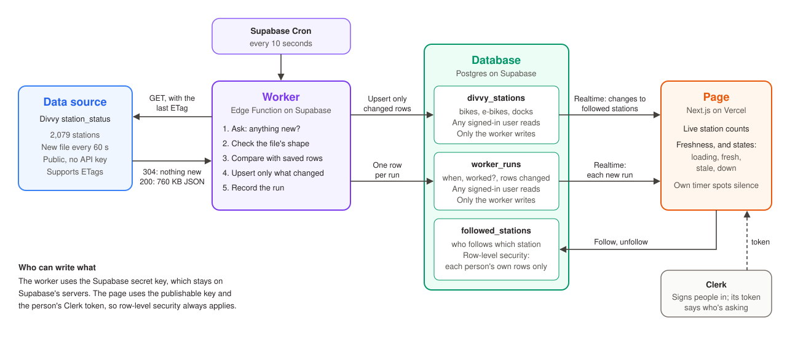

# Estaciones

Follow the Divvy bike stations you use, and watch bikes and docks change live, without refreshing. Assignment 5: a live data system.

**Live site:** https://projectdbs-a5-live-data-system.vercel.app

## How data moves



Drawn before the code. [docs/data-flow.md](docs/data-flow.md) walks through each step, what each field means, and what breaks if a part changes.

1. **Supabase Cron** calls the worker every 10 seconds.
2. **The worker** (`supabase/functions/divvy-worker`) asks Divvy for its status file, sending the last ETag. If nothing's new, Divvy answers 304 and sends no data.
3. **On a new file,** which Divvy publishes every 60 seconds, the worker checks its shape, compares it with the saved rows, and upserts only the stations whose bikes, e-bikes, docks or status changed: about 30 of 2,079 per file.
4. **Every run** adds a row to `worker_runs`, including runs that fail or change nothing.
5. **Supabase Realtime** pushes each new run, and each change to a station the person follows, to the open page.

## How someone knows the data is current

The status bar stays in view and is always in one of four states.

| State | When |
|---|---|
| **Connecting** (loading) | The first data hasn't arrived. Placeholders show, never zeros |
| **Live** (fresh) | The last run worked, it ran within 60 seconds, and Divvy's data is under 5 minutes old |
| **Out of date** (stale) | No run for over 60 seconds, or Divvy's data is over 5 minutes old. The page's own timer notices, because when the worker stops, no event arrives to say so |
| **Not updating** (down) | The worker's last run failed. The last good numbers stay, with their age |

## Who can see and change what

- **The worker** writes with the Supabase secret key, which Supabase gives it on its own servers. Its URL is public, so it only acts on a private token that Cron sends, kept in Supabase Vault.
- **The page** uses the publishable key and the person's Clerk token, so row-level security always applies.
- **`followed_stations`:** row-level security limits each person to their own rows. The browser never sends `user_id`; the database fills it in from the Clerk token.
- **`divvy_stations`, `worker_runs`:** signed-in people can read them. Only the worker writes.

## Free tier limits

- **Edge Function calls:** a run every 10 seconds is about 259,000 of the 500,000 a month.
- **Realtime:** saving only what changed keeps messages low. A page gets one message per run and one per change to a station it follows.
- **Database:** an hourly job keeps 7 days of runs and 1 day of Cron's records.

To stop the worker, run `select cron.unschedule('divvy-worker-every-10-seconds');` in the SQL editor.

## Run it locally

```bash
npm install
npm run dev     # http://localhost:3000
```

Put these in `.env.local` (names only; the values come from the Clerk and Supabase dashboards):

| Variable | What it is |
|---|---|
| `NEXT_PUBLIC_CLERK_PUBLISHABLE_KEY` | Clerk publishable key |
| `CLERK_SECRET_KEY` | Clerk secret key (server only) |
| `NEXT_PUBLIC_SUPABASE_URL` | Supabase project URL |
| `NEXT_PUBLIC_SUPABASE_PUBLISHABLE_KEY` | Supabase publishable key |
| `E2E_USER_A_EMAIL`, `E2E_USER_B_EMAIL` | Two test users in the Clerk development instance (only for the Playwright tests) |

## Tests

```bash
npm test            # the worker and the freshness rules
npm run test:e2e    # the real page and database, in a browser
E2E_BASE_URL=https://projectdbs-a5-live-data-system.vercel.app npm run test:e2e   # the same, on the deployed site
```

- **`tests/worker.test.ts`** runs the real worker logic on saved Divvy responses, with a pretend database. It checks that only real changes are saved, a 304 saves nothing, and bad data saves nothing and records a failed run.
- **`tests/freshness.test.ts`** checks the rules for each state, including the real refused Realtime event that once made the page say "down".
- **`tests/live.spec.ts`** signs in two people and checks that each sees only their own stations, that the page keeps updating without a refresh, and that Realtime comes back after the connection is cut.

Decisions and what went wrong, round by round, are in [DECISIONS.md](DECISIONS.md).
