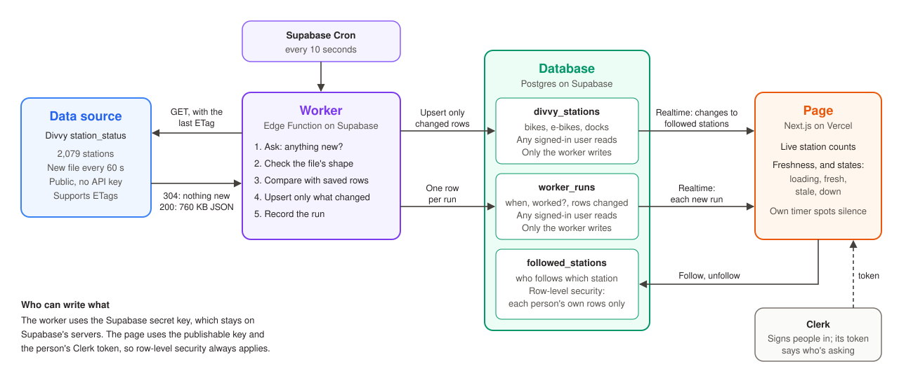

# Data flow

Drawn before any code, from a real test of the source.

## The source: Divvy `station_status`

`https://gbfs.lyft.com/gbfs/1.1/chi/en/station_status.json`. Public, no API key.

### What I tested (Nov 2, 2026, about 8:20 PM)

- **Two calls 244 seconds apart:** 131 of 2,079 stations changed their bikes, e-bikes or docks.
- **40 calls, 15 seconds apart:** the data changed once every 60 seconds, as the feed's `ttl: 60` says. A copy could already be about 95 seconds old, because it comes through a CDN.
- **Conditional requests:** sending `If-None-Match` with the last ETag returns `304` and 0 bytes when nothing is new. A full response is about 760 KB.

### The fields

| Field | What it means | How often it changes | Do we need it? |
|---|---|---|---|
| `last_updated` (top level) | When Divvy published this file | Every 60 s | Yes: freshness |
| `ttl` (top level) | Seconds until the next file | Never | No: it told us the schedule |
| `station_id` | The station's permanent id | Never | Yes: primary key |
| `num_bikes_available` | Bikes you can take, including e-bikes | When someone rides or returns | Yes |
| `num_ebikes_available` | E-bikes among those | Same | Yes |
| `num_docks_available` | Free docks to return to | Same | Yes |
| `is_installed`, `is_renting`, `is_returning` | Whether the station is working | Rarely | Yes: a closed station isn't "0 bikes" |
| `last_reported` | When the station last checked in | Constantly | **No: see below** |
| `num_bikes_disabled`, `num_docks_disabled` | Broken bikes and docks | Sometimes | No |
| `num_scooters_*`, `eightd_*`, `legacy_id` | Not useful for this page | | No |

Station names, locations and capacity aren't in this file. They're in `station_information.json` (1.1 MB), which rarely changes, so the worker fetches it only when it sees a station it doesn't know.

**Why `last_reported` is left out.** In the same 4 minutes it changed at 1,147 stations, while availability changed at 131. Saving it would mean about 9 times the writes and Realtime messages, with nothing new for a person to see.

## What each part sends the next, and what breaks if it changes

| From → to | What it sends | If that changes or fails |
|---|---|---|
| **Cron → Worker** | A POST every 10 seconds with a private token | If Cron stops, nothing arrives at the page, so there's no error to show. The page's own timer notices the silence and shows **stale**. |
| **Source → Worker** | `304`, or JSON with `data.stations[]` | If Divvy renames a field, the shape check fails. The run is recorded as failed and nothing is saved, so the page shows **down** instead of wrong numbers. |
| **Worker → `divvy_stations`** | An upsert of only the changed rows | If it rewrites every row, Realtime sends thousands of messages per run and the free quota is gone within hours. |
| **Worker → `worker_runs`** | One row per run: when, whether it worked, rows changed, the source's timestamp | If it stops, the page can't tell how fresh the data is. |
| **`divvy_stations` → Page** | Each changed row of a followed station, through Realtime | If the table isn't in Realtime, read access isn't granted, or there's no policy, the page gets nothing **with no error**. |
| **`worker_runs` → Page** | Each new run, through Realtime | The same silent failure, but it looks like **stale** even though the worker is fine. |
| **Page → `followed_stations`** | Follow and unfollow, with the Clerk token | If row-level security is off, people can read and change each other's choices. |
| **Clerk → Page** | A session token that lasts about a minute | Realtime asks for a new token on every heartbeat. Without that, a page left open would go quiet. |

## The page's states

| State | When | What the person sees |
|---|---|---|
| **Loading** | The first data hasn't arrived | Placeholders, not zeros: "0 bikes" would be a false statement |
| **Fresh** | The last run worked, it ran under 60 s ago, and Divvy's data is under 5 minutes old | "Updated 12 s ago" |
| **Stale** | No run for 60 s (about 6 missed runs), or Divvy's data is over 5 minutes old | The numbers stay, dimmed, with how old they are |
| **Down** | The worker's last run failed | The last good numbers, a clear message, and when they were last good |
